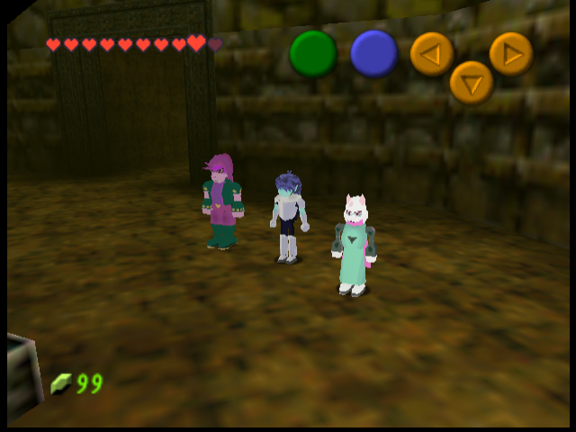
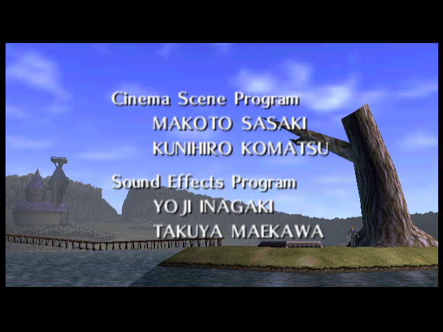
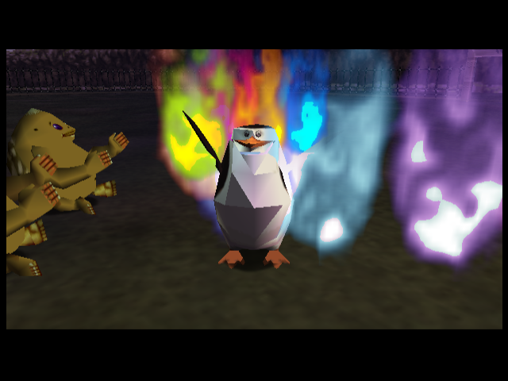
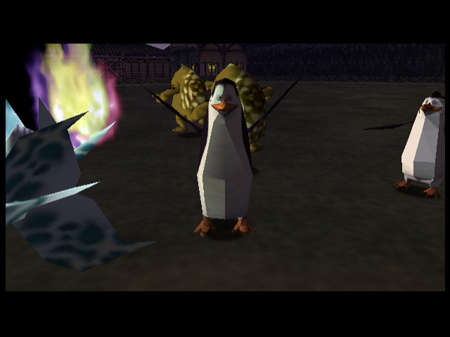
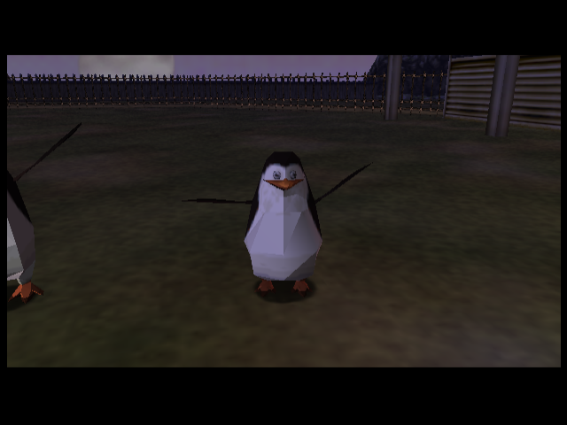
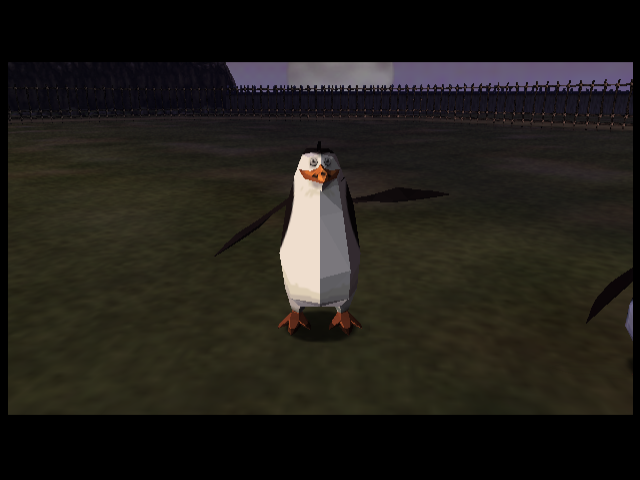

# Trio und Credits, V53

**Das engere Trio in Dodongos Höhle**

**Moseby auf der Insel: ursprüngliche Credits-Kamera**

**Starwalker beim letzten Kameraschwenk auf der Feier**

**Getrennte Flügel: vergrößerte Emulator-Kontrollansichten**

Für diese vier Ansichten wurde der Credits-Shot nur im Test angehalten, die Kamera näher gesetzt und die Beschriftung ausgeblendet. Die Flügelanimation läuft dabei weiter. Pingu bleibt unverändert.

**Skipper**

**Kowalski**

**Private**

**Rico**

