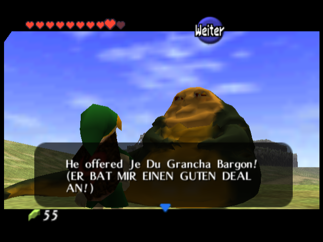
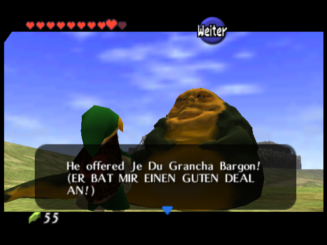

# Jabba: Gesicht hat Vorrang

Gesamtpatch gegen unveränderte Europa/PAL 1.0. Vanilla-MD5 `e040de91a74b61e3201db0e2323f768a`, Ziel-SHA256 `37659d6445fcb544cc8bc3176172dd059a4273740f30f942f95be97ee319aba2`. Alle bisherigen Änderungen enthalten, ROM weiterhin 40 MiB, Laufzeit mit tatsächlichen 4 MiB geprüft.

## Ergebnis

Gesichtsfront mit 1.111 Dreiecken und eigener durchgehender 64×64-CI4-Textur. Zuvor hatte der gesamte Kopf einschließlich Rückseite 511 Dreiecke und teilte sich seine Textur in viele kleine UV-Inseln. Beide Augen behalten ihre eigenen Netze, ursprünglichen Positionen und UVs (95/96 Dreiecke). Neue Aufteilung: Körper/Schwanz 859, Kopfrückseite 130, Gesichtsfront 1.111, Augen 191; insgesamt 2.291 statt 2.391 Dreiecke. Die feiner rekonstruierte Oberfläche (Voxel 0,04) wird mit vorrangigem Erhalt von Lidern, Nase, Lippen und Wangen vereinfacht. Körper und Schwanz erhalten weniger Geometrie.

Diffuse Originalfarben auf die vereinfachten Flächen gebacken. Das Gesicht nutzt eine kontinuierliche frontale Projektion über seine eigene volle Texturfläche, dazu milde lokale Kontaktverschattung aus der dichten Vorlage (Distanz 0,4, Mischung 0,65) für erkennbare Mund-/Lidfalten. Kein fest eingebranntes Richtungslicht; native Szenenbeleuchtung und Nebel bleiben aktiv. Vier nacheinander geladene kleine CI4-Texturen, je 64×64/16 Farben; keine Vergrößerung des Texturpuffers oder der Textur pro Ladevorgang. Uniforme Höhe 78 und zwei eigene starre Animationsgruppen erhalten. Keine vergrößerte Kamera, kein für Bilder versetzter NPC.

Das vollständige Objekt schrumpft von 93.712 auf 82.080 Byte, also 11.632 Byte weniger. Kein neuer Akteurs-/Objekt-Slot. In den geprüften Kinder-Abschnitten bleiben mindestens 190,320 Byte im Objektpuffer frei. Die native Zelda-Arena meldet null fehlgeschlagene Speicherbelegungen; größte freie zusammenhängende Fläche mindestens 46,944 Byte. Objektpuffer und Arena getrennt gemessen.

## Vergleich und Laufzeit

Gegen den zuletzt gelieferten Jabba-Build sind exakt fünf Segmente verändert: Jabbas eigenes Modellobjekt, dessen Umfang in der nativen Objekttabelle, der unveränderte Display-List-Verweis mit neuer Adresse und der zur Höhe passende Kopfdrehpunkt im Elf_Msg2-Overlay, DMA-Verzeichnis und ROM-Prüfsumme. Alle anderen Modell-/Szenensegmente und sämtliche bisherigen Texte sind bytegleich. Keine Änderungen an Dialoglogik, Größe, Standort, Kollisionsregeln oder Altersprüfung. Huttisch und deutsche Klammerübersetzung bleiben wortgetreu.

Zusätzliche Gesamtprüfung gegen die Fassung vor Jabba: alle 1.510 komprimierten Segmente gegen den unkomprimierten Build, CIC-6105-Prüfsumme, 3.664 native Kernfunktionen/Datensymbole und sämtliche 1.031 eigenen Nachrichten-/Seitenpuffer bestanden. Die neue Nachricht 71B3 behält ihren gültigen Folge-DMA-Zeiger.

Vier abgeschlossene gezielte Laufzeitproben mit dem neuen Modell: Kind tags vor den drei Steinen (700 Frames), Kind tags nach den drei Steinen (700), Kind nachts (500) und Erwachsener als Abwesenheitskontrolle (500). In allen drei Kinder-Proben alle fünf Dialogseiten geöffnet; keine beobachteten Grafikbefehlsfehler, Pufferüberläufe oder fehlgeschlagenen nativen Speicherbelegungen. Tests verwenden normale Eingaben und native Kamera; lokale Start-Fixtures richten nur Spieler/Fortschritt ein. Kein neuer vollständiger Spieldurchlauf oder Hardwaretest in diesem Schritt.

RomPatcher.js mit aktiver Quellvalidierung erzeugt bytegenau diese geprüfte Produktions-ROM. BPS ausschließlich auf die entpackte unveränderte Vanilla-PAL-1.0-ROM anwenden. Alte Emulator-Savestates können noch alte Objekte enthalten; normal gespeicherten Spielstand laden.

## Bilder

Unveränderte echte Emulatorbilder, gleiche Tages-Startposition und normale Gesprächskamera für Vorher/Nachher. `Jabba_Gesicht_Vorher.png` stammt aus der vorherigen ROM `d090fc67ed85e5416181ead5250af5996b86b58e3d05c7f7adf2cde4b6a6fdf6`, alle Nachher-Bilder aus der Ziel-ROM oben. Das neue Modell ist in der Spielansicht beurteilt worden, nicht anhand einer höher aufgelösten Blender-Vorschau.

## Quellen

Vorbereitete Modell-JSON/PNGs und aktuelle Builder enthalten. Letzter Schritt nach `build_ben_ice.py`: `python3 tools/build_jabba.py <oot>`, anschließend normal bauen/komprimieren. Blender-Neuableitung: `prepare_jabba_lowpoly.py`, `bake_jabba_colors.py`, `export_jabba.py`, jeweils `-- <arbeitsordner>` mit entpacktem Nutzer-Upload unter `input/`. Keine ROMs, Saves, Savestates, RAM-Abzüge, ausführbaren Dateien oder dichte GLB veröffentlicht. Vergleichsskripte benötigen die privaten vorherigen ROM/ELF-Dateien, die nicht mitgeliefert werden.
