# V42: Panzer mit Kollision und friedliche Wald-Dekus

[Normal-Patch](Mr_Burns_Mr_Bean_DE_PAL10_Panzer_Dekus_V42.bps?raw=true) · [DEBUG-Patch](Mr_Burns_Mr_Bean_DE_PAL10_DEBUG_Panzer_Dekus_V42.bps?raw=true) · [Quellen und Patches](Merzen_Panzer_Dekus_V42_Quellen_Patch.zip?raw=true) · [Änderungen und Texte](Panzer_Dekus_V42_Aenderungen.md)

Panzer am Todesberg stehen am Rand und haben einfache Rumpfkollision. Drei zusätzliche Panzer stehen im erwachsenen Kakariko. In Wawarios Zelle wartet ein unbewaffneter Gorone. In den erwachsenen Verlorenen Wäldern stehen der grüne Panzer und drei friedliche Dekus mit Deinen Texten. Alle bisherigen Änderungen sind enthalten.

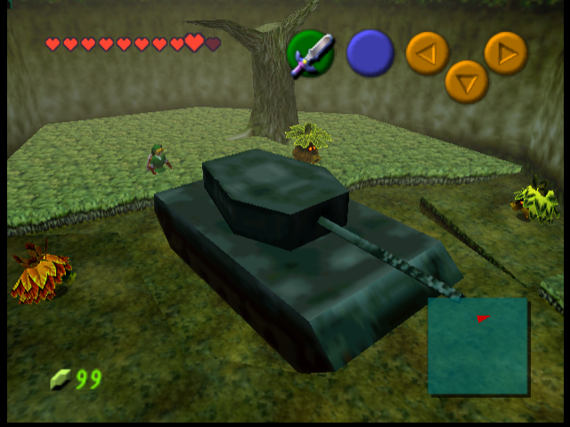

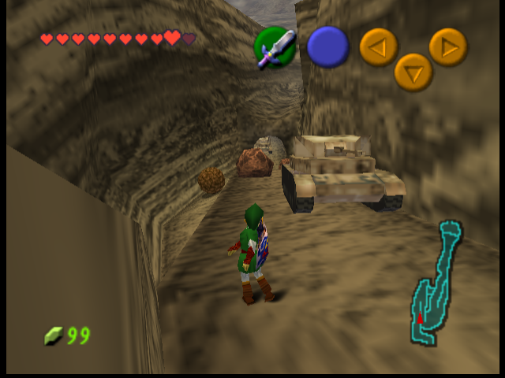

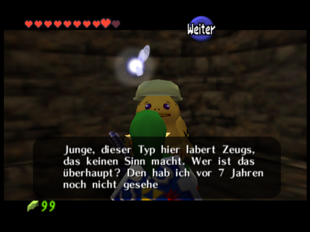

Gezielte 4-MiB-Tests bestanden; kein vollständiger Spieldurchlauf. Patches auf die saubere europäische PAL 1.0 anwenden. DEBUG: L+R halten und Z drücken.

# V41: Wawa-Brüder am mittleren Festungsausgang

[Normal-Patch](Mr_Burns_Mr_Bean_DE_PAL10_Credits_V41.bps?raw=true) · [DEBUG-Patch](Mr_Burns_Mr_Bean_DE_PAL10_DEBUG_Credits_V41.bps?raw=true) · [Quellen und Patches](Merzen_Credits_V41_Quellen_Patch.zip?raw=true) · [Änderungen](Credits_V41_Aenderungen.md)

Wawario links direkt vor dem tatsächlichen mittleren Durchgang, Wawaluigi rechts daneben, beide einander zugewandt. Die Original-Kamerafahrt bleibt unverändert. In Mauzis Einstellung stehen jetzt vier entfernte, verlassene Panzer.

[MP4 mit Originalmusik](Credits_Wawa_Durchgang_Panzer_V41.mp4?raw=true)

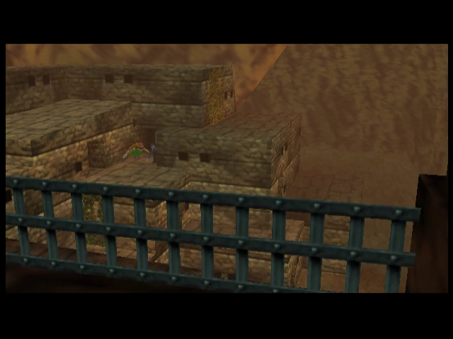

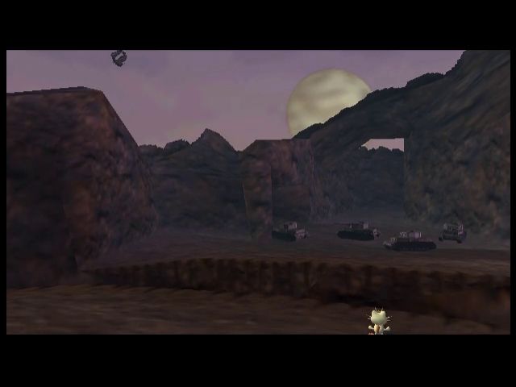

Normal und DEBUG mit 4 MiB geprüft. Auf eine saubere europäische PAL-1.0-ROM anwenden; alle bisherigen Änderungen sind enthalten. DEBUG: L+R halten und Z drücken.

# V40: Panzer, Grenz-Soldaten und originale Credits-Kamera

[Normal-Patch](Mr_Burns_Mr_Bean_DE_PAL10_Panzer_V40.bps?raw=true) · [DEBUG-Patch](Mr_Burns_Mr_Bean_DE_PAL10_DEBUG_Panzer_V40.bps?raw=true) · [Änderungen](Panzer_V40_Aenderungen.md) · [Quellen und Patches](Merzen_Panzer_V40_Quellen_Patch.zip?raw=true)

[Gesamter Dialog: Gerudotal, Wüste und Geistertempel](Storydialoge_Gerudotal_Wueste_Geistertempel.md) · [Textdatei](Storydialoge_Gerudotal_Wueste_Geistertempel.txt?raw=true)

Acht Panzer: drei am erwachsenen Todesberg, je zwei im Gerudotal und davor im Hyrule-Feld, einer allein in der Ferne im Mauzi-Credits-Shot. Dazu sechs neue bewaffnete Goronen mit Deinen Grenz-Dialogen. Armeehelme sitzen tiefer. Alle bisherigen Änderungen sind enthalten.

Die Original-Kamerafahrt ist wiederhergestellt. Wawario steht links und Wawaluigi rechts auf dem vorhandenen Dach; der Zaun bleibt erhalten. [Credits-MP4 mit Originalmusik](Credits_Mauzi_Panzer_Wawa_V40.mp4?raw=true).

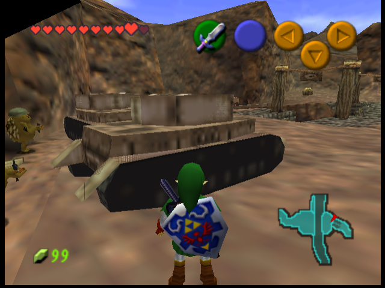

Gezielte Tests mit 4 MiB. Patch auf die saubere europäische PAL 1.0 .z64 anwenden. DEBUG: L+R halten und Z drücken.

[Gesamter aktueller Dialog: Gerudotal, Wüste und Geistertempel](Storydialoge_Gerudotal_Wueste_Geistertempel.md) · [Textdatei](Storydialoge_Gerudotal_Wueste_Geistertempel.txt?raw=true)

# V39: Goronen-Soldaten und korrigierte Credits-Standorte

[Normal-Patch](Mr_Burns_Mr_Bean_DE_PAL10_Soldaten_V39.bps?raw=true) · [DEBUG-Patch](Mr_Burns_Mr_Bean_DE_PAL10_DEBUG_Soldaten_V39.bps?raw=true) · [Änderungen und alle sechs Dialoge](Soldaten_V39_Aenderungen.md) · [Quellen und Patches](Merzen_Soldaten_V39_Quellen_Patch.zip?raw=true)

Sieben bewaffnete Goronen in der Erwachsenen-Zeitlinie: zwei vor Goronia, einer neben der Bombe, zwei am Todesberg-Tor, einer in Kakariko und einer in den Verlorenen Wäldern. Sie bleiben stehen und tragen die neuen Gespräche. Alle bisherigen Änderungen sind enthalten.

Wawario und Wawaluigi stehen in den Credits auf einem vorhandenen Dach, Mauzi direkt auf dem Boden. [MP4 mit Originalmusik](Credits_Mauzi_Wawa_V39.mp4?raw=true).

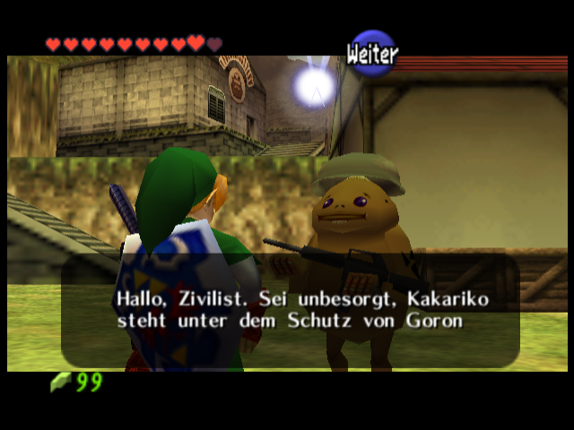

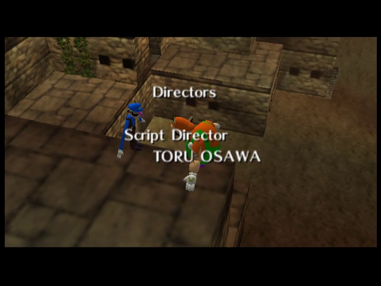

Normal und DEBUG in den geänderten Abschnitten mit 4 MiB geprüft. DEBUG: L+R halten → Z → „Credits starten“ → A.

Patch auf die saubere europäische PAL 1.0 .z64 anwenden, nicht auf eine ältere gepatchte Version.

# V38: Credits und zusätzliche Feuertempel-Texte

[Normal-Patch](Mr_Burns_Mr_Bean_DE_PAL10_Credits_V38.bps?raw=true) · [DEBUG-Patch](Mr_Burns_Mr_Bean_DE_PAL10_DEBUG_Credits_V38.bps?raw=true) · [Änderungen und Dialoge](Credits_V38_Aenderungen.md) · [Quellen und Patches](Merzen_Credits_V38_Quellen_Patch.zip?raw=true)

Darunia, Wallace und Darunias Sohn haben die zusätzlichen Gesprächstexte; der Inquisitionssatz ist entfernt. Außerdem: überarbeiteter Bombentransport mit vier Bauhelm-Goronen, türkisfarbener Okto, Rutos Rückkehr sowie Wawario, Wawaluigi und Mauzi in den Credits. Alle bisherigen Änderungen sind enthalten.

Normal und DEBUG in den geänderten Abschnitten mit 4 MiB geprüft. DEBUG: L+R halten → Z → „Credits starten“ → A. Die natürliche Credits-Kette und die Rückkehr ins Spiel funktionieren mit Originalmusik.

Videos mit Spielmusik und Spielgeräuschen:

- [Mauzi und die Wawa-Figuren](Credits_Mauzi_Wawa_V38.mp4?raw=true)
- [Goronen und Bombe](Credits_Goronen_Bombe_V38.mp4?raw=true)
- [Okto und Ruto](Credits_Okto_Ruto_V38.mp4?raw=true)

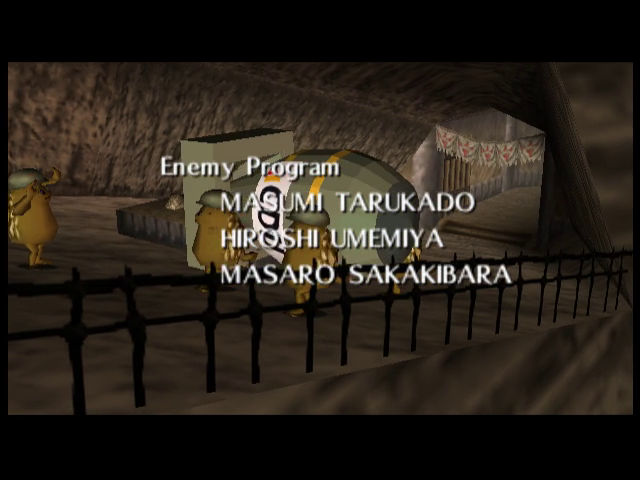

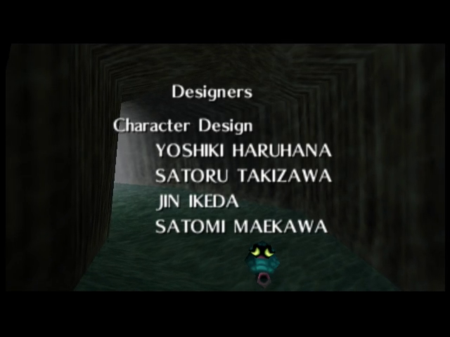

Patch auf die saubere europäische PAL 1.0 .z64 anwenden, nicht auf eine ältere gepatchte Version.

# Credits V37: Goronen räumen die CDU-Bombe weg

[Normal-Patch](Mr_Burns_Mr_Bean_DE_PAL10_Credits_V37.bps?raw=true) · [DEBUG-Patch](Mr_Burns_Mr_Bean_DE_PAL10_DEBUG_Credits_V37.bps?raw=true) · [Änderungen](Credits_V37_Aenderungen.md) · [Quellen und Patches](Merzen_Credits_V37_Quellen_Patch.zip?raw=true)

Vier Goronen tragen mit Soldatenhelmen die CDU-Bombe, ein Einweiser gibt Rangierzeichen und drei Goronen mit gelben Bauhelmen nähern sich im Hintergrund. Nur die erste Todesberg-Kamerafahrt im Abspann. Alle bisherigen Änderungen enthalten. Normal und DEBUG mit 4 MiB geprüft. DEBUG: L+R halten → Z → „Credits starten“ → A.

[MP4 mit Originalmusik und Spielgeräuschen](Credits_Goronen_Bombe_V37.mp4?raw=true)

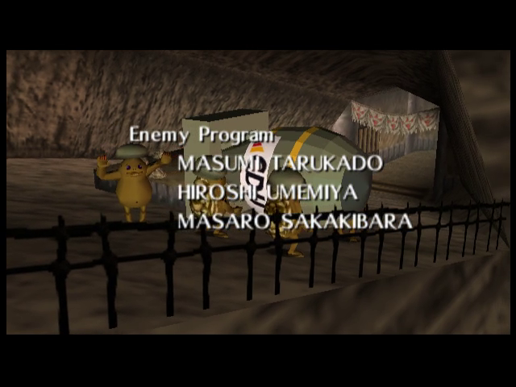

Patch auf eine saubere PAL 1.0 .z64 anwenden, nicht auf eine ältere gepatchte Version.

# Credits V36: Abspann aus dem Debug-Menü starten

[Normal-Patch](Mr_Burns_Mr_Bean_DE_PAL10_Credits_V36.bps?raw=true) · [DEBUG-Patch](Mr_Burns_Mr_Bean_DE_PAL10_DEBUG_Credits_V36.bps?raw=true) · [Änderungen](Credits_V36_Aenderungen.md) · [Quellen und Patches](Merzen_Credits_V36_Quellen_Patch.zip?raw=true)

DEBUG: L+R gedrückt halten und Z drücken → ganz oben „Credits starten“ wählen → A. Der Abspann startet mit Originalmusik und läuft über seine normalen Szenenwechsel weiter. Der Deku-Händler hält jetzt eine Pepsi-Dose, die seiner Handanimation folgt. Alle bisherigen Änderungen enthalten. Mit 4 MiB geprüft.

[MP4 mit Originalmusik und Spielgeräuschen](Credits_Deku_Pepsi_V36.mp4?raw=true)

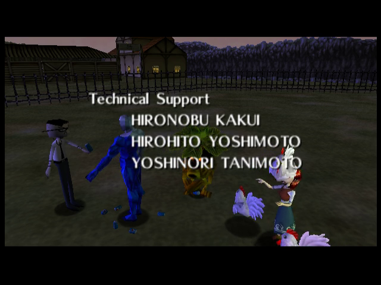

Patch auf eine saubere PAL 1.0 .z64 anwenden, nicht auf eine ältere gepatchte Version.

# Credits V35: Deku-Händler in der Mitte

[Normal-Patch](Mr_Burns_Mr_Bean_DE_PAL10_Credits_V35.bps?raw=true) · [DEBUG-Patch](Mr_Burns_Mr_Bean_DE_PAL10_DEBUG_Credits_V35.bps?raw=true) · [Änderungen](Credits_V35_Aenderungen.md) · [Quellen und Patches](Merzen_Credits_V35_Quellen_Patch.zip?raw=true)

Der bestehende tanzende Deku-Händler steht jetzt zwischen Pepsiman und der Hühnerfrau, leicht nach hinten versetzt. Alle anderen Positionen und Animationen bleiben unverändert. Alle bisherigen Änderungen enthalten. Einstellung in Normal und DEBUG mit 4 MiB geprüft.

[MP4 mit Originalmusik und Spielgeräuschen](Credits_Deku_Mitte_V35.mp4?raw=true)

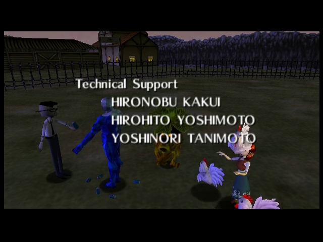

Patch auf eine saubere PAL 1.0 .z64 anwenden, nicht auf eine ältere gepatchte Version.

# Credits V34: Pinguin-Tänze und Pepsiman/Crocker im Gespräch

[Normal-Patch](Mr_Burns_Mr_Bean_DE_PAL10_Credits_V34.bps?raw=true) · [DEBUG-Patch](Mr_Burns_Mr_Bean_DE_PAL10_DEBUG_Credits_V34.bps?raw=true) · [Änderungen](Credits_V34_Aenderungen.md) · [Quellen und Patches](Merzen_Credits_V34_Quellen_Patch.zip?raw=true)

Pepsiman und Crocker schauen einander an und gestikulieren wie in einem Gespräch. Die vier Madagascar-Pinguine tanzen mit großen, schnellen Flossenbewegungen. Terris Arme sind entspannt abgesenkt; Beine und Unterkörper bleiben hinter der Kiste verdeckt. Der bestätigte Pingu-Auftritt und Shaggy/Fred bleiben unverändert. Alle bisherigen Änderungen enthalten; Normal und DEBUG mit 4 MiB geprüft.

**MP4 mit originaler Credits-Musik und Spielgeräuschen:** [Komplette Ranch-Feier](Credits_Gaeste_V34.mp4?raw=true) · [Kurzer Zusammenschnitt der Änderungen](Credits_Feinschliff_V34.mp4?raw=true)

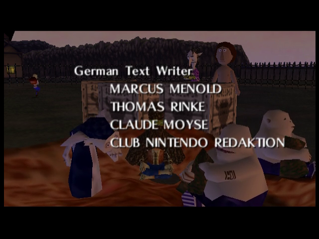

[Credits Pinguine V34](Credits_Pinguine_V34.png) · [Credits Pinguine Goronen V34](Credits_Pinguine_Goronen_V34.png) · [Credits Terri V34](Credits_Terri_V34.png) · [Credits Crocker Pepsi V34](Credits_Crocker_Pepsi_V34.png)

Die Musik stammt direkt aus der Emulation. Für den Testeinstieg wurde der übernommene Musikstatus zurückgesetzt; Musikdaten und Audiologik im Spiel wurden nicht geändert. Beide Patches auf eine saubere PAL 1.0 .z64 anwenden, nicht auf eine ältere gepatchte Version.

# Credits V33: Pingu-Tanz, Tresen-Terri und große Gesten

[Normal-Patch](Mr_Burns_Mr_Bean_DE_PAL10_Credits_V33.bps?raw=true) · [DEBUG-Patch](Mr_Burns_Mr_Bean_DE_PAL10_DEBUG_Credits_V33.bps?raw=true) · [Änderungen](Credits_V33_Aenderungen.md) · [Quellen und Patches](Merzen_Credits_V33_Quellen_Patch.zip?raw=true)

Pingu sichtbar rechts hinter Mario mit schnellen, großen Flossenbewegungen. Terri schaut über die Kiste, seine Beine bleiben verdeckt. Crocker steht links von Pepsiman und hält eine Pepsi; Shaggy/Fred gestikulieren deutlich stärker. Alle bisherigen Änderungen enthalten; Normal und DEBUG mit 4 MiB geprüft.

**MP4 mit originaler Credits-Musik und Spielgeräuschen:** [Komplette Ranch-Feier](Credits_Gaeste_V33.mp4?raw=true) · [Kurzer Zusammenschnitt der Änderungen](Credits_Feinschliff_V33.mp4?raw=true)

[Credits Pingu V33](Credits_Pingu_V33.png) · [Credits Terri V33](Credits_Terri_V33.png) · [Credits Mystery Inc V33](Credits_Mystery_Inc_V33.png) · [Credits Taenzer V33](Credits_Taenzer_V33.png) · [Credits Crocker Pepsi V33](Credits_Crocker_Pepsi_V33.png) · [Credits Pepsi Dosen V33](Credits_Pepsi_Dosen_V33.png)

Die Musik stammt direkt aus der Emulation. Für den Testeinstieg wurde der übernommene Musikstatus zurückgesetzt; Musikdaten und Audiologik im Spiel wurden nicht geändert. Beide Patches auf eine saubere PAL 1.0 .z64 anwenden, nicht auf eine ältere gepatchte Version.

# Credits V32: Verteilung, Gesten und Originalmusik

[Normal-Patch](Mr_Burns_Mr_Bean_DE_PAL10_Credits_V32.bps?raw=true) · [DEBUG-Patch](Mr_Burns_Mr_Bean_DE_PAL10_DEBUG_Credits_V32.bps?raw=true) · [Änderungen](Credits_V32_Aenderungen.md) · [Quellen und Patches](Merzen_Credits_V32_Quellen_Patch.zip?raw=true)

Crocker frei sichtbar, Terri hinter der Kiste mit bewegten Armen, nähere Kamerafahrt der Viererreihe, Gesprächsgesten für Shaggy/Fred und mehr Abstand der Pinguine zu den Zoras. Alle bisherigen Änderungen enthalten; Normal und DEBUG mit 4 MiB geprüft.

**MP4 mit originaler Credits-Musik und Spielgeräuschen:** [Komplette Ranch-Feier](Credits_Gaeste_V32.mp4?raw=true) · [Kurzer Zusammenschnitt der Änderungen](Credits_Feinschliff_V32.mp4?raw=true)

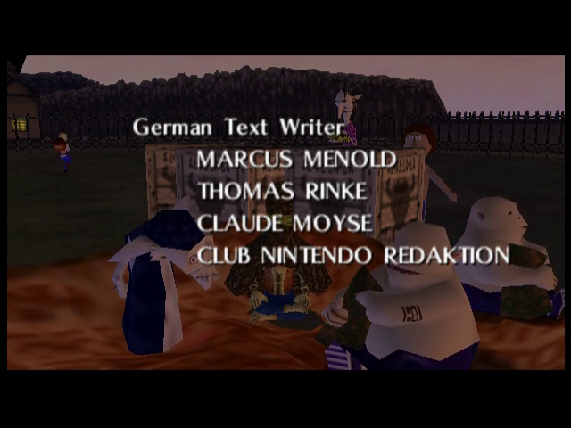

[Credits Pinguine V32](Credits_Pinguine_V32.png) · [Credits Terri V32](Credits_Terri_V32.png) · [Credits Mystery Inc V32](Credits_Mystery_Inc_V32.png) · [Credits Taenzer V32](Credits_Taenzer_V32.png) · [Credits Crocker Deku Pepsi V32](Credits_Crocker_Deku_Pepsi_V32.png) · [Credits Pepsi Dosen V32](Credits_Pepsi_Dosen_V32.png)

Die Musik stammt direkt aus der Emulation. Für den Testeinstieg wurde der übernommene Musikstatus zurückgesetzt; Musikdaten und Audiologik im Spiel wurden nicht geändert. Beide Patches auf eine saubere PAL 1.0 .z64 anwenden, nicht auf eine ältere gepatchte Version.

# Credits und zweiter Erbsenhändler V31

[Normal-Patch](Mr_Burns_Mr_Bean_DE_PAL10_Credits_V31.bps?raw=true) · [DEBUG-Patch](Mr_Burns_Mr_Bean_DE_PAL10_DEBUG_Credits_V31.bps?raw=true) · [Änderungen](Credits_V31_Aenderungen.md) · [Quellen und Patches](Merzen_Credits_V31_Quellen_Patch.zip?raw=true)

Volle Tanzstärke für Fanboy und Crocker, Fanboy/Chum Chum getauscht, schnellere Wawa-Arme, nähere Vierer-Tanzreihe, sechs Pepsi-Dosen und ein tanzender Deku-Händler. Neuer zweiter Erbsenhändler mit Chips-Dialog am Zora-Fluß, nur als Kind. Echter Wario und die Teppich-Anpassung unverändert. Alle früheren Änderungen enthalten; gezielt mit 4 MiB geprüft.

**MP4 mit Spielton:** [Kurzes Tanzupdate](Credits_Tanzupdate_V31.mp4?raw=true) · [Komplette Ranch-Feier](Credits_Gaeste_V31.mp4?raw=true)

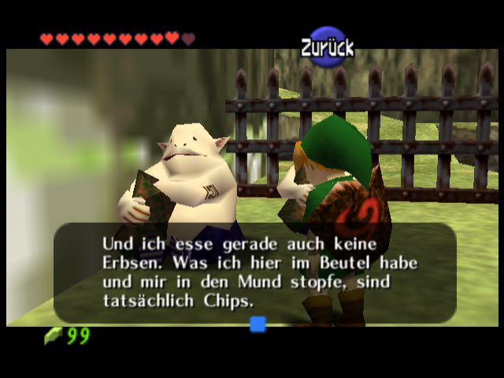

[Credits Fanboy ChumChum V31](Credits_Fanboy_ChumChum_V31.png) · [Credits Taenzer V31](Credits_Taenzer_V31.png) · [Credits Crocker Deku Pepsi V31](Credits_Crocker_Deku_Pepsi_V31.png) · [Credits Pepsi Dosen V31](Credits_Pepsi_Dosen_V31.png) · [Credits Wawario Bros V31](Credits_Wawario_Bros_V31.png) · [Anderer Erbsenhaendler V31](Anderer_Erbsenhaendler_V31.png) · [Erbsenhaendler Chips V31](Erbsenhaendler_Chips_V31.png)

# Credits V30

[Normal-Patch](Mr_Burns_Mr_Bean_DE_PAL10_Credits_V30.bps?raw=true) · [DEBUG-Patch](Mr_Burns_Mr_Bean_DE_PAL10_DEBUG_Credits_V30.bps?raw=true) · [Änderungen](Credits_V30_Aenderungen.md) · [Quellen und Patches](Merzen_Credits_V30_Quellen_Patch.zip?raw=true)

Lockerere Gruppen im Hintergrund, geerdete Figuren mit Szenenlicht und Schatten, mehr Abstand zwischen Wario und Mido, angepaßte Teppich-Sitzflächen und Marty/Doc neben Link. Kleine Tänze für Fanboy und Crocker. Franky unverändert. Alle früheren Änderungen enthalten. Gezielt mit 4 MiB geprüft.

**MP4 mit Spielton:** [Ranch-Credits](Credits_Gaeste_V30.mp4?raw=true) · [Letzter Hof](Marty_Doc_Credits_V30.mp4?raw=true) · [Fanboy/Crocker-Tanz](Fanboy_Crocker_Tanz_V30.mp4?raw=true)

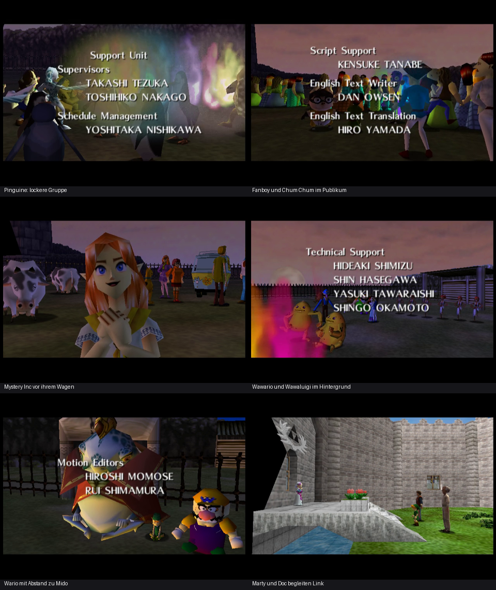

[Credits Pinguine V30](Credits_Pinguine_V30.png) · [Credits Fanboy ChumChum V30](Credits_Fanboy_ChumChum_V30.png) · [Credits Wundererbsen V30](Credits_Wundererbsen_V30.png) · [Credits Mystery Inc V30](Credits_Mystery_Inc_V30.png) · [Credits Taenzer V30](Credits_Taenzer_V30.png) · [Credits Pepsiman V30](Credits_Pepsiman_V30.png) · [Credits Wawario Bros V30](Credits_Wawario_Bros_V30.png) · [Credits Wario V30](Credits_Wario_V30.png) · [Credits Marty Doc V30](Credits_Marty_Doc_V30.png) · [Credits Mido Rueckansicht V30](Credits_Mido_Rueckansicht_V30.png)

# Credits V29

[Normal-Patch](Mr_Burns_Mr_Bean_DE_PAL10_Credits_V29.bps?raw=true) · [DEBUG-Patch](Mr_Burns_Mr_Bean_DE_PAL10_DEBUG_Credits_V29.bps?raw=true) · [Änderungen](Credits_V29_Aenderungen.md) · [Quellen und Patches](Merzen_Credits_V29_Quellen_Patch.zip?raw=true)

Neue Credits-Gäste samt Tänzen, Wario bei Mido und König Zora, Mystery Inc mit Wagen und Marty/Doc im letzten Hof. Originale Bowlingfrau und die beiden Riesen-Goronen entfernt. Alle früheren Änderungen enthalten. Gezielt mit 4 MiB RAM geprüft.

**MP4 mit Spielton:** [Ranch-Credits](Credits_Gaeste_V29.mp4?raw=true) · [Marty und Doc im letzten Hof](Marty_Doc_Credits_V29.mp4?raw=true)

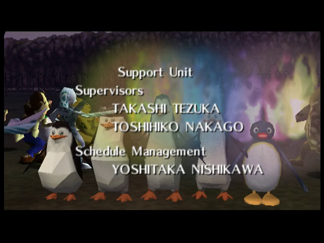

[Credits Fanboy ChumChum V29](Credits_Fanboy_ChumChum_V29.png) · [Credits Wundererbsen V29](Credits_Wundererbsen_V29.png) · [Credits Mystery Inc V29](Credits_Mystery_Inc_V29.png) · [Credits Taenzer V29](Credits_Taenzer_V29.png) · [Credits Pepsiman V29](Credits_Pepsiman_V29.png) · [Credits Wawario Bros V29](Credits_Wawario_Bros_V29.png) · [Credits Wario V29](Credits_Wario_V29.png) · [Credits Marty Doc V29](Credits_Marty_Doc_V29.png)

# Franky und Handhelds V28

[Normal](Mr_Burns_Mr_Bean_DE_PAL10_Franky_Handhelds_V28.bps?raw=true) · [DEBUG](Mr_Burns_Mr_Bean_DE_PAL10_DEBUG_Franky_Handhelds_V28.bps?raw=true) · [Änderungen](Franky_Handhelds_V28_Aenderungen.md) · [Quellen](Merzen_Franky_Handhelds_V28_Quellen_Patch.zip?raw=true)

Franky die Heugabel auf der Farm, im Schloß, kaputt in der Endarena und geklebt in der Farmfeier der Credits. Navi-Fundstück im Krater; Game Boy Color und Advance im Kokiri-Tunnel, je nach Links Alter. Alle früheren Änderungen enthalten. Gezielt mit 4 MiB RAM geprüft.

[Franky-Credits als MP4](Franky_Credits_V28.mp4?raw=true) · [Barinades Todessequenz als MP4](Barinade_Todessequenz_V28.mp4?raw=true)

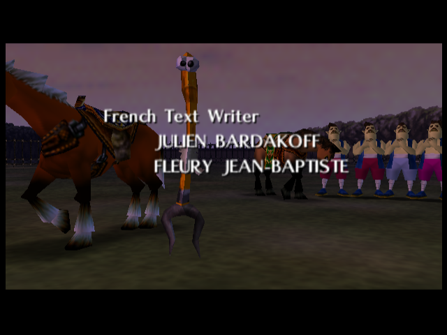

[Franky Farm Kind V28](Franky_Farm_Kind_V28.png) · [Franky Farm Erwachsen V28](Franky_Farm_Erwachsen_V28.png) · [Franky Schloss V28](Franky_Schloss_V28.png) · [Franky Kaputt V28](Franky_Kaputt_V28.png) · [Triple T Credits V28](Triple_T_Credits_V28.png) · [Triple T Abspann V28](Triple_T_Abspann_V28.png) · [Krater V28](Krater_V28.png) · [Game Boy Color V28](Game_Boy_Color_V28.png) · [Game Boy Advance V28](Game_Boy_Advance_V28.png)

# Brunnen-Ergänzung V27

[Normal](Mr_Burns_Mr_Bean_DE_PAL10_Brunnen_V27.bps?raw=true) · [DEBUG](Mr_Burns_Mr_Bean_DE_PAL10_DEBUG_Brunnen_V27.bps?raw=true) · [Änderungen](Brunnen_V27_Aenderungen.md) · [Quellen](Merzen_Brunnen_V27_Quellen_Patch.zip?raw=true)

Kleine statische Anordnung der hochgeladenen Modelle auf vorhandener roter Bodenfläche im Brunnen, mit Navis Kommentar. Pinguine und Dynamit sind in den Einsturz-Fluchtszenen nicht enthalten. Alle bisherigen Änderungen enthalten. Gezielt mit 4 MiB RAM geprüft.

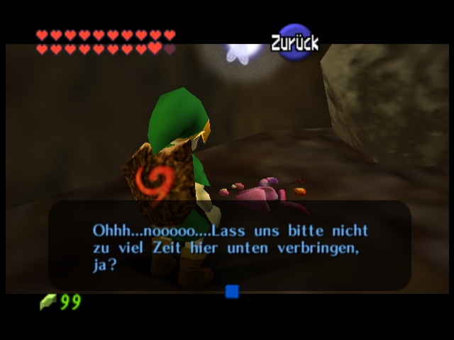

# Pinguine und Modellkorrekturen V26

[Normal](Mr_Burns_Mr_Bean_DE_PAL10_Pinguine_Fixes_V26.bps?raw=true) · [DEBUG](Mr_Burns_Mr_Bean_DE_PAL10_DEBUG_Pinguine_Fixes_V26.bps?raw=true) · [Änderungen](Pinguine_Fixes_V26_Aenderungen.md) · [Quellen](Merzen_Pinguine_Fixes_V26_Quellen_Patch.zip?raw=true)

Terris falsche Texturwiederholung und Pingus Flügelhaltung sind korrigiert. Skipper, Kowalski, Private und Rico stehen mit Dynamit in vier Schloß-Räumen. Gezielt mit 4 MiB RAM geprüft; alle bisherigen Änderungen enthalten.

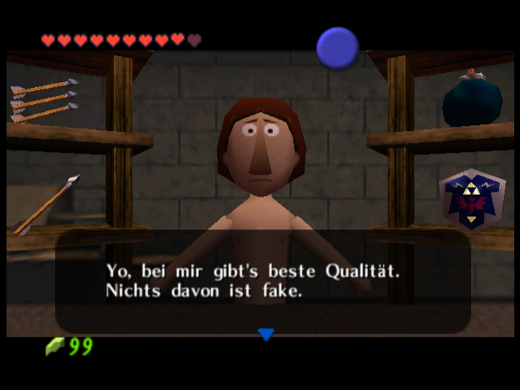

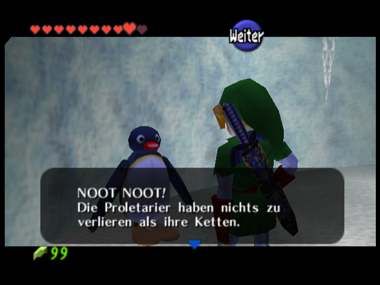

[Skipper](Skipper_V26.png) · [Kowalski](Kowalski_V26.png) · [Private](Private_V26.png) · [Rico](Rico_V26.png)

# Pingu, Crazy Frog und Terri V25

[Normal](Mr_Burns_Mr_Bean_DE_PAL10_Pingu_Frog_Terri_V25.bps?raw=true) · [DEBUG](Mr_Burns_Mr_Bean_DE_PAL10_DEBUG_Pingu_Frog_Terri_V25.bps?raw=true) · [Änderungen](Pingu_Frog_Terri_V25_Aenderungen.md) · [Quellen](Merzen_Pingu_Frog_Terri_V25_Quellen_Patch.zip?raw=true)

Terri ohne Helm ersetzt den Basarhändler. Pingu in der Eishöhle und Crazy Frog am Froschplatz. Kleine Bewegungen, mit 4 MiB RAM geprüft; Basarkauf in beiden Zeitlinien getestet. Alle bisherigen Änderungen enthalten.

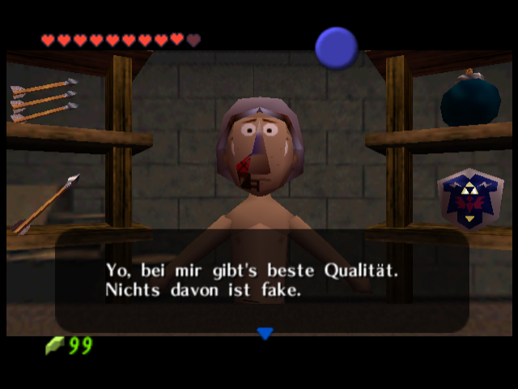

# Triangle Guy V24

[Normal](Mr_Burns_Mr_Bean_DE_PAL10_Triangle_V24.bps?raw=true) · [DEBUG](Mr_Burns_Mr_Bean_DE_PAL10_DEBUG_Triangle_V24.bps?raw=true) · [Video mit Ton](Triangle_Guy_V24_Gesicht_Arme_mit_Ton.mp4?raw=true) · [Änderungen](Triangle_Guy_V24_Aenderungen.md) · [Quellen](Merzen_Triangle_V24_Quellen_Patch.zip?raw=true)

Triangle Guy steht mit Link innerhalb des Feuerrings vor Zelda, hat sauberere Augen und winkende Arme. Mit 4 MiB RAM und regulärem Ansprechen geprüft. Alle bisherigen Änderungen enthalten.

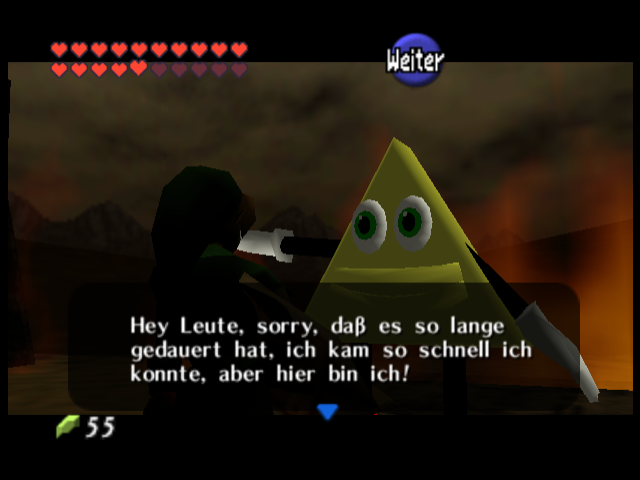

# Goronia V23: Video mit Ton

[MP4 herunterladen](Goronia_Bombe_V23_Test_mit_Ton.mp4?raw=true) · [Hinweise](Goronia_Bombe_V23_Test_mit_Ton.md)

42 Sekunden: erst langsame Musik und Navi, ab 0:27 normales Tempo zum Vergleich. Aufnahme mit tatsächlichem Spielton und 4 MiB RAM; die V23-Patches bleiben unverändert.

# Goronia: CDU-Bombe V23

[Normal](Mr_Burns_Mr_Bean_DE_PAL10_Goronia_Bombe_V23.bps?raw=true) · [DEBUG](Mr_Burns_Mr_Bean_DE_PAL10_DEBUG_Goronia_Bombe_V23.bps?raw=true) · [Änderungen](Goronia_Bombe_V23_Aenderungen.md) · [Quellen](Merzen_Goronia_Bombe_V23_Quellen_Patch.zip?raw=true)

Große Bombe mit CDU-Emblem, vier getrennte Donnerblumen, langsame Goronia-Musik bis zum Feuer-Amulett und zwei Navi-Seiten beim Anvisieren. Mit 4 MiB RAM geprüft. Alle bisherigen Änderungen enthalten; auf unveränderte PAL 1.0 anwenden.

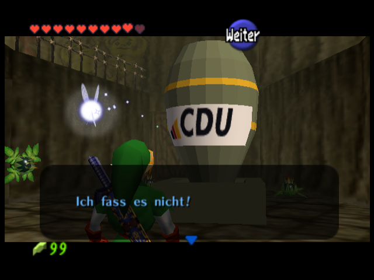

# Wallace und Nachspiel V22

[Normal](Mr_Burns_Mr_Bean_DE_PAL10_Wallace_V22.bps?raw=true) · [DEBUG](Mr_Burns_Mr_Bean_DE_PAL10_DEBUG_Wallace_V22.bps?raw=true) · [Sechs neue Texte](Wallace_V22_Aenderungen.md) · [Quellen](Merzen_Wallace_V22_Quellen_Patch.zip?raw=true)

[Neue Dialogliste bis Wassertempel](Storydialoge_nach_Feuertempel_bis_Wassertempel.md) · [Als TXT](Storydialoge_nach_Feuertempel_bis_Wassertempel.txt?raw=true)

Wallace nach der Befreiung, Goronia-Nachspiel und Fados Tauschquest-Texte überarbeitet. Neue Arbeitsliste bis Wassertempel; feste Textzeiten erhalten. Alle bisherigen Änderungen enthalten; jeweils auf unveränderte PAL 1.0 anwenden.

# Arbeitsliste: nach Feuertempel bis Wassertempel

[Alle Dialoge lesen](Storydialoge_nach_Feuertempel_bis_Wassertempel.md) · [TXT herunterladen](Storydialoge_nach_Feuertempel_bis_Wassertempel.txt?raw=true) · [ZIP herunterladen](Storydialoge_nach_Feuertempel_bis_Wassertempel.zip?raw=true)

116 Text-IDs, 244 Textbox-Seiten: Zoras Reich, Eishöhle, Sheik, Thaddäus, Navi, Okto, Pepsiman, Fanboy und Chum Chum. König-Zora-Varianten, Hylia-See, Labor, Tauschquest, erwachsener Doofenshmirtz und Zielerfassung im Anhang. Aktueller V22-Textbestand; reiner Export.

# Goronia und Feuertempel V21

[Normal](Mr_Burns_Mr_Bean_DE_PAL10_Feuertempel_V21.bps?raw=true) · [DEBUG](Mr_Burns_Mr_Bean_DE_PAL10_DEBUG_Feuertempel_V21.bps?raw=true) · [16 neue Texte](Feuertempel_V21_Aenderungen.md) · [Quellen](Merzen_Feuertempel_V21_Quellen_Patch.zip?raw=true)

[Aktuelle Dialoge bis Feuertempel](Storydialoge_Masterschwert_bis_Feuertempel.md) · [Als TXT](Storydialoge_Masterschwert_bis_Feuertempel.txt?raw=true)

Darunias Sohn, Wallace-Antwortzweig, Darunia und die gefangenen Goronen überarbeitet. Wallace selbst bleibt für die Fortsetzung unverändert; feste Textzeiten erhalten. Alle bisherigen Änderungen enthalten; jeweils auf unveränderte PAL 1.0 anwenden.

# Tripple T und Goronen V20

[Normal](Mr_Burns_Mr_Bean_DE_PAL10_Sahur_Goronen_V20.bps?raw=true) · [DEBUG](Mr_Burns_Mr_Bean_DE_PAL10_DEBUG_Sahur_Goronen_V20.bps?raw=true) · [Elf neue Texte](Sahur_Goronen_V20_Aenderungen.md) · [Quellen](Merzen_Sahur_Goronen_V20_Quellen_Patch.zip?raw=true)

[Aktuelle Dialoge bis Feuertempel](Storydialoge_Masterschwert_bis_Feuertempel.md) · [Als TXT](Storydialoge_Masterschwert_bis_Feuertempel.txt?raw=true)

Tripple T, Mido und Darunias Sohn: Projekt Atom-Donnerblume, Wallace und Volvagia. 3036 bleibt für die Fortsetzung unverändert; feste Textzeiten erhalten. Alle bisherigen Änderungen enthalten; jeweils auf unveränderte PAL 1.0 anwenden.

# Waldkapitel V19

[Normal](Mr_Burns_Mr_Bean_DE_PAL10_Wald_V19.bps?raw=true) · [DEBUG](Mr_Burns_Mr_Bean_DE_PAL10_DEBUG_Wald_V19.bps?raw=true) · [15 neue Texte](Wald_V19_Aenderungen.md) · [Quellen](Merzen_Wald_V19_Quellen_Patch.zip?raw=true)

[Aktuelle Dialoge bis Feuertempel](Storydialoge_Masterschwert_bis_Feuertempel.md) · [Als TXT](Storydialoge_Masterschwert_bis_Feuertempel.txt?raw=true)

Boris, Kokiri, Mido, Sheik, Fanghaken/Feenbogen und Merz nach Amthors Niederlage überarbeitet. Feste Textzeiten erhalten. Alle bisherigen Änderungen enthalten; jeweils auf unveränderte PAL 1.0 anwenden.

# Sheik V18

[Normal](Mr_Burns_Mr_Bean_DE_PAL10_Sheik_V18.bps?raw=true) · [DEBUG](Mr_Burns_Mr_Bean_DE_PAL10_DEBUG_Sheik_V18.bps?raw=true) · [Fünf neue Texte](Sheik_V18_Aenderungen.md) · [Quellen](Merzen_Sheik_V18_Quellen_Patch.zip?raw=true)

[Aktuelle Dialoge bis Feuertempel](Storydialoge_Masterschwert_bis_Feuertempel.md) · [Als TXT](Storydialoge_Masterschwert_bis_Feuertempel.txt?raw=true)

Sheiks fünf neue Nachrichten, der bisherige Zukunft-Schluß von 7057 bleibt erhalten. Habeck unangetastet. Alle bisherigen Änderungen enthalten; jeweils auf unveränderte PAL 1.0 anwenden.

# Arbeitsliste: Master-Schwert bis Feuertempel

[Vollständige Dialoge lesen](Storydialoge_Masterschwert_bis_Feuertempel.md) · [Als TXT herunterladen](Storydialoge_Masterschwert_bis_Feuertempel.txt?raw=true) · [Arbeitsliste als ZIP](Storydialoge_Masterschwert_bis_Feuertempel.zip?raw=true)

Aktueller V17-Wortlaut: 164 Text-IDs, 433 Seiten, einschließlich Auswahlzweigen und Wiederholungszuständen. Vom Schwertziehen und Erwachen bei Habeck über Waldtempel und Goronia bis Wallace/Feueramulett und unmittelbaren Reaktionen. Verbliebene Originaltexte und gespeicherte Zusatzvarianten sind gekennzeichnet. Reiner Export; Spiel und Patches unverändert.

# Dialoge V17

[Normal](Mr_Burns_Mr_Bean_DE_PAL10_Dialoge_V17.bps?raw=true) · [DEBUG](Mr_Burns_Mr_Bean_DE_PAL10_DEBUG_Dialoge_V17.bps?raw=true) · [Änderungen](Dialoge_V17_Aenderungen.md) · [Quellen](Merzen_Dialoge_V17_Quellen_Patch.zip?raw=true)

[Waldkapitel lesen](Storydialoge_Masterschwert_bis_Waldtempel.md) · [Arbeitsliste als TXT](Storydialoge_Masterschwert_bis_Waldtempel.txt?raw=true) · [Liste als ZIP](Storydialoge_Masterschwert_bis_Waldtempel.zip?raw=true)

Fünf gewünschte Textänderungen; aktuelle Abschrift Master-Schwert bis Waldtempel mit 116 IDs. Alle bisherigen Änderungen enthalten; jeweils auf unveränderte PAL 1.0 anwenden.

# Ortsnamen V16

[Normal](Mr_Burns_Mr_Bean_DE_PAL10_Ortsnamen_V16.bps?raw=true) · [DEBUG](Mr_Burns_Mr_Bean_DE_PAL10_DEBUG_Ortsnamen_V16.bps?raw=true) · [Änderung/Prüfung](Ortsnamen_V16_Aenderungen.md) · [Quellen](Merzen_Ortsnamen_V16_Quellen_Patch.zip?raw=true)

Deutsche Ortsnamen: Friedrichs Schloß (Einblendung und Karte), Mr. Beans Haus (neue native Hauseinblendung, Kind und Erwachsener mit 4 MiB geprüft). Alle bisherigen Änderungen enthalten; jeweils auf unveränderte PAL 1.0 anwenden.

# Barinade: rote Spritzer V15

[Normal](Mr_Burns_Mr_Bean_DE_PAL10_Barinade_Rot_V15.bps?raw=true) · [DEBUG](Mr_Burns_Mr_Bean_DE_PAL10_DEBUG_Barinade_Rot_V15.bps?raw=true) · [Änderung/Prüfung](Barinade_Rot_V15_Aenderungen.md) · [Quellen](Merzen_Barinade_Rot_V15_Quellen_Patch.zip?raw=true)

Barinades vorhandene grüne Spritzer und Bodenflecken sind jetzt rot. Keine zusätzlichen Partikel oder Speicherbelegung. Alle bisherigen Änderungen enthalten; jeweils auf unveränderte PAL 1.0 anwenden.

# Navi: Eisenstangen V14

[Normal](Mr_Burns_Mr_Bean_DE_PAL10_Navi_Knast_V14.bps?raw=true) · [DEBUG](Mr_Burns_Mr_Bean_DE_PAL10_DEBUG_Navi_Knast_V14.bps?raw=true) · [Änderung/Prüfung](Navi_Knast_V14_Aenderungen.md) · [Quellen](Merzen_Navi_Knast_V14_Quellen_Patch.zip?raw=true)

0202: „Ja, dicke Eisenstangen blockieren die Tür. Das erinnert mich an meine Zeit im Knast.“ Alle bisherigen Änderungen enthalten; jeweils auf unveränderte PAL 1.0 anwenden.

# Texttempo und Triple-T-Debugfehler V13

[Normal](Mr_Burns_Mr_Bean_DE_PAL10_Texttempo_Wald_V13.bps?raw=true) · [DEBUG](Mr_Burns_Mr_Bean_DE_PAL10_DEBUG_Texttempo_Wald_V13.bps?raw=true) · [Änderungen und Prüfung](Texttempo_Wald_V13_Aenderungen.md) · [Quellen](Merzen_Texttempo_Wald_V13_Quellen_Patch.zip?raw=true)

Allgemeines Texttempo etwas schneller, auch für manuell bestätigte Cutscene-Dialoge. Feste Einblendzeiten unverändert. Debug-Waldzustand korrigiert: Sahur bleibt nach dem Feuer-Rückblick erhalten. Alle bisherigen Änderungen enthalten. Gesamtpatch auf unveränderte PAL 1.0 anwenden.

# Jabu-Jabu bis Master-Schwert V12

[Normal](Mr_Burns_Mr_Bean_DE_PAL10_Jabu_Dialoge_V12.bps?raw=true) · [Debug](Mr_Burns_Mr_Bean_DE_PAL10_DEBUG_Jabu_Dialoge_V12.bps?raw=true) · [Eingebaute neue Texte](Jabu_Dialoge_V12_Texte.md) · [Prüfung](Jabu_Dialoge_V12_Aenderungen.md) · [Quellen](Merzen_Jabu_Dialoge_V12_Quellen_Patch.zip?raw=true)

32 neue Texte von Jabu-Jabu bis zum Master-Schwert, inklusive beider Ruto-Wunschzweige. Gelobte Texte bleiben erhalten; feste Einblendzeiten unverändert. Alle bisherigen Inhalte enthalten. Gesamtpatch jeweils auf unveränderte Vanilla PAL 1.0 anwenden. Die vollständige Arbeitsliste von Dodongo bis zum Master-Schwert ist ebenfalls aktualisiert.

# Zora-Reich V11

[Normal](Mr_Burns_Mr_Bean_DE_PAL10_Zora_Dialoge_V11.bps?raw=true) · [Debug](Mr_Burns_Mr_Bean_DE_PAL10_DEBUG_Zora_Dialoge_V11.bps?raw=true) · [Eingebaute neue Texte](Zora_Dialoge_V11_Texte.md) · [Prüfung](Zora_Dialoge_V11_Aenderungen.md) · [Quellen](Merzen_Zora_Dialoge_V11_Quellen_Patch.zip?raw=true)

19 neue Zora-/Thaddäus-Texte mit neuem Tauchspiel-Start und König-Zora-Flaschenpost. Gelobte Texte bleiben erhalten. Alle bisherigen Inhalte enthalten. Gesamtpatch jeweils auf unveränderte Vanilla PAL 1.0 anwenden. Die vollständige Arbeitsliste von Dodongo bis zum Master-Schwert ist ebenfalls aktualisiert.

# Goronen-Nachspiel V10

[Normal](Mr_Burns_Mr_Bean_DE_PAL10_Goronen_Nachspiel_V10.bps?raw=true) · [Debug](Mr_Burns_Mr_Bean_DE_PAL10_DEBUG_Goronen_Nachspiel_V10.bps?raw=true) · [Eingebaute neue Texte](Goronen_Nachspiel_V10_Texte.md) · [Prüfung](Goronen_Nachspiel_V10_Aenderungen.md) · [Quellen](Merzen_Goronen_Nachspiel_V10_Quellen_Patch.zip?raw=true)

21 neue Dialogtexte nach Dodongo, bei der Fee und in Navi-/Salia-Kommentaren. 3027 und die Eule bleiben erhalten. Alle bisherigen Inhalte enthalten. Gesamtpatch jeweils auf unveränderte Vanilla PAL 1.0 anwenden. Die vollständigen Arbeitslisten Kapitel 1–2 sind ebenfalls aktualisiert.

# Dialogliste: nach Dodongo bis zum Master-Schwert

[Dialoge lesen](Storydialoge_Dodongo_bis_Masterschwert.md) · [Textdatei](Storydialoge_Dodongo_bis_Masterschwert.txt?raw=true) · [Download als ZIP](Storydialoge_Dodongo_bis_Masterschwert.zip?raw=true)

185 Text-IDs aus dem aktuellen V9-Spielstand, mit Seiten, Antworten und Varianten. Endet bei Merz nach dem Ziehen des Schwerts, vor Robert Habecks menschlichem Auftritt. Reine Arbeitsliste; keine ROM-Änderung.

# Goronen- und Darunia-Dialoge V9

[Normal](Mr_Burns_Mr_Bean_DE_PAL10_Goronen_Dialoge_V9.bps?raw=true) · [Debug](Mr_Burns_Mr_Bean_DE_PAL10_DEBUG_Goronen_Dialoge_V9.bps?raw=true) · [Eingebaute neue Texte](Goronen_Dialoge_V9_Texte.md) · [Prüfung](Goronen_Dialoge_V9_Aenderungen.md) · [Quellen](Merzen_Goronen_Dialoge_V9_Quellen_Patch.zip?raw=true)

22 überarbeitete Goronen-/Darunia-/Navi-Texte. 3009 und die abgebrochene 0119-Vorgabe bleiben stehen. Alle bisherigen Inhalte enthalten. Gesamtpatch jeweils auf unveränderte Vanilla PAL 1.0 anwenden. Die vollständigen Arbeitslisten Kapitel 1–2 sind ebenfalls aktualisiert.

# Schloß- und Wald-Dialoge V8

[Normal](Mr_Burns_Mr_Bean_DE_PAL10_Schloss_Wald_V8.bps?raw=true) · [Debug](Mr_Burns_Mr_Bean_DE_PAL10_DEBUG_Schloss_Wald_V8.bps?raw=true) · [Eingebaute neue Texte](Schloss_Wald_V8_Texte.md) · [Prüfung](Schloss_Wald_V8_Aenderungen.md) · [Quellen](Merzen_Schloss_Wald_V8_Quellen_Patch.zip?raw=true)

30 überarbeitete Texte mit der C-/Netz-Korrektur und genau einer Nietzsche-Erwähnung (1029). Alle bisherigen Inhalte enthalten. Gesamtpatch jeweils auf unveränderte Vanilla PAL 1.0 anwenden. Die vollständigen Arbeitslisten Kapitel 1–2 sind ebenfalls aktualisiert.

# Kokiri-Dialoge V7: neue Texte am Spielanfang

[Normal](Mr_Burns_Mr_Bean_DE_PAL10_Kokiri_Dialoge_V7.bps?raw=true) · [Debug](Mr_Burns_Mr_Bean_DE_PAL10_DEBUG_Kokiri_Dialoge_V7.bps?raw=true) · [Eingebaute neue Texte](Kokiri_Dialoge_V7_Texte.md) · [Prüfung](Kokiri_Dialoge_V7_Aenderungen.md) · [Quellen](Merzen_Kokiri_Dialoge_V7_Quellen_Patch.zip?raw=true)

29 überarbeitete Texte für Kokiri, Navi, Mido, Salia und Deku-Baum. Alle bisherigen Inhalte enthalten. Gesamtpatch jeweils auf unveränderte Vanilla PAL 1.0 anwenden. Die vollständigen Arbeitslisten Kapitel 1–2 sind ebenfalls aktualisiert.

# Ganon-Kopfsitz V6: Burns sitzt näher am Körper

[Normal](Mr_Burns_Mr_Bean_DE_PAL10_Ganon_Kopfsitz_V6.bps?raw=true) · [Debug](Mr_Burns_Mr_Bean_DE_PAL10_DEBUG_Ganon_Kopfsitz_V6.bps?raw=true) · [Neue Verwandlungs-MP4](Ganon_Kopfsitz_V6.mp4?raw=true) · [Änderungen/Prüfung](Ganon_Kopfsitz_V6_Aenderungen.md) · [Quellen](Merzen_Ganon_Kopfsitz_V6_Quellen_Patch.zip?raw=true)

Bestienkopf tiefer und näher am Hals/Kragen. Alle bisherigen Inhalte, menschlicher Merz und Kindheits-Burns erhalten. Gesamtpatch je auf Vanilla PAL 1.0 anwenden.

# Finale Burns V5: native Körper mit Burns-Köpfen

[Normal](Mr_Burns_Mr_Bean_DE_PAL10_Finale_Burns_V5.bps?raw=true) · [Debug](Mr_Burns_Mr_Bean_DE_PAL10_DEBUG_Finale_Burns_V5.bps?raw=true) · [Merz-Video](Merz_Ganondorf_Koerper.mp4?raw=true) · [Ganon-Verwandlung](Ganon_Burns_Verwandlung.mp4?raw=true) · [Änderungen/Prüfung](Finale_Burns_V5_Aenderungen.md) · [Quellen](Merzen_Finale_Burns_V5_Quellen_Patch.zip?raw=true)

Kindheit bleibt vollständiger Burns. Erwachsene Ganondorf-Auftritte im Schloß/Finale: nativer Körper mit Burns-Kopf. Ganon: Bestienkörper mit großem Burns-Kopf. Kumulativer Gesamtpatch; je auf Vanilla PAL 1.0 anwenden. Alle bisherigen Inhalte und Texte erhalten.

# Storydialoge Kapitel 1–2 zum Überarbeiten

[Hauptstrang: Intro bis nach Dodongos Höhle](Storydialoge_Kapitel_1_2_Hauptstrang.md) · [Nebenhandlungen/Bewohner](Storydialoge_Kapitel_1_2_Nebenhandlungen.md) · [Hauptstrang als Textdatei](Storydialoge_Kapitel_1_2_Hauptstrang.txt?raw=true) · [Nebenhandlungen als Textdatei](Storydialoge_Kapitel_1_2_Nebenhandlungen.txt?raw=true)

Aktuell eingebaute deutsche Texte aus Charakterbewegung V4, mit IDs und Seiten. 224 Hauptstrang-Textzustände und 202 optionale Ergänzungen. Antwortzweige, Wiederholungen und Navi-Ausnahmen markiert; auch noch nicht neu geschriebene Passagen enthalten. Keine Änderung an ROM oder Patch.

# Charakterbewegung V4: Triangle Guy lebt auf

[Normal](Mr_Burns_Mr_Bean_DE_PAL10_Charakterbewegung_V4.bps?raw=true) · [Debug](Mr_Burns_Mr_Bean_DE_PAL10_DEBUG_Charakterbewegung_V4.bps?raw=true) · [Video](Triangle_Guy_Bewegung.mp4?raw=true) · [Änderungen/Prüfung](Charakterbewegung_V4_Aenderungen.md) · [Quellen](Merzen_Charakterbewegung_V4_Quellen_Patch.zip?raw=true)

Neue Figuren auf Bewegung geprüft; Triangle Guy erhält entspannte Arme, Ruhebewegung und Gesprächsgeste. Vorhandene Animationen beibehalten. Kumulativer Gesamtpatch, je auf Vanilla PAL 1.0 anwenden.

# Running Man V3: Vor-Rettungsdialog ergänzt

[Normal](Mr_Burns_Mr_Bean_DE_PAL10_Running_Man_V3.bps?raw=true) · [Debug](Mr_Burns_Mr_Bean_DE_PAL10_DEBUG_Running_Man_V3.bps?raw=true) · [Änderungen/Prüfung](Running_Man_V3_Aenderungen.md) · [Quellen](Merzen_Running_Man_V3_Quellen_Patch.zip?raw=true)

Neuer Running-Man-Dialog vor Befreiung der Zimmerleute, späteres Rennangebot erhalten. Kumulativer Gesamtpatch, je auf Vanilla PAL 1.0 anwenden.

# NPC-Dialoge V2: Wegzusätze entfernt, Twinrova nennt Merz

[Normaler Gesamtpatch](Mr_Burns_Mr_Bean_DE_PAL10_NPC_Dialoge_V2.bps?raw=true) · [Debug-Gesamtpatch](Mr_Burns_Mr_Bean_DE_PAL10_DEBUG_NPC_Dialoge_V2.bps?raw=true) · [Änderungen/Prüfung](NPC_Dialoge_V2_Aenderungen.md) · [Quellen](Merzen_NPC_Dialoge_V2_Quellen_Patch.zip?raw=true)

Alle bisherigen Inhalte. Überflüssige Wegzusätze entfernt, bei Koume/Kotakes Kampfeinleitung Ganondorf durch Friedrich Merz ersetzt. Die 35 getrennten Erst-/Wiederholungsdialoge bleiben erhalten. Deutsch, Vanilla PAL 1.0, jeweils einen Gesamtpatch anwenden. Debugsteuerung unverändert.

# Getrennte Erst- und Wiederholungsdialoge

[Normaler Gesamtpatch](Mr_Burns_Mr_Bean_DE_PAL10_NPC_Dialoge.bps?raw=true) · [Debug-Gesamtpatch](Mr_Burns_Mr_Bean_DE_PAL10_DEBUG_NPC_Dialoge.bps?raw=true) · [Änderungen/Prüfung](NPC_Dialoge_Aenderungen.md) · [Quellen](Merzen_NPC_Dialoge_Quellen_Patch.zip?raw=true)

Alle bisherigen Inhalte. 35 bestätigte Erst-/Wiederholungs-Paare getrennt; die Gesichtsfrau sagt beim ersten Mal nur noch die Pointe. Deutsch, Vanilla PAL 1.0, jeweils nur einen Gesamtpatch anwenden. Debugsteuerung unverändert.

# Debugversion und passende Gewandicons

[Debug-Gesamtpatch](Mr_Burns_Mr_Bean_DE_PAL10_DEBUG.bps?raw=true) · [Normaler Gesamtpatch](Mr_Burns_Mr_Bean_DE_PAL10_Gewandicons.bps?raw=true) · [Bedienung](Debug_Bedienung.md) · [Bilder](Debug_Beispielbilder/) · [Quellen](Merzen_Debug_Gewandicons_Quellen_Patch.zip?raw=true)

Alle bisherigen Inhalte einschließlich Schattengewand. Orange/hellblaue Gewandicons in beiden Fassungen. Debug: L+R halten und Z drücken; im offenen Pausemenü L für den Inventar-Editor. Je einen Patch auf Vanilla PAL 1.0 anwenden. Separate Testspielstandkopie verwenden. Gezielte 4-MiB-Proben bestanden, kein vollständiger Spieldurchlauf.

# Schattengewand im Brunnen

[Gesamtpatch](Mr_Burns_Mr_Bean_DE_PAL10_Schattengewand.bps?raw=true) · [Bilder](Schattengewand_Beispielbilder/) · [Fundtext](Schattengewand_Fundtext.md) · [Quellen](Merzen_Schattengewand_Quellen_Patch.zip?raw=true)

Alle früheren Änderungen enthalten. Schwarzes Standardgewand für beide Altersstufen aus einer neuen Brunnen-Truhe. Der neue Halbierungsschutz gilt nur mit dem Schattengewand; Feuer-/Wassergewand schalten ihn aus. Schwarze Icons und schwarzes Fundmodell. Auf unveränderte Vanilla PAL 1.0 anwenden. Gezielte 4-MiB-Proben und native Speicherung geprüft; kein vollständiger Spieldurchlauf.

# Doofenshmirtz, Shrek und Mr. Monopoly

[Gesamtpatch](Mr_Burns_Mr_Bean_DE_PAL10_Doof_Shrek_Monopoly.bps?raw=true) · [Dialoge](Dialoge_Doof_Shrek_Monopoly.md) · [Beispielbilder](Doof_Shrek_Monopoly_Beispielbilder/) · [Quellen](Merzen_Doof_Shrek_Monopoly_Quellen_Patch.zip?raw=true)

Alle früheren Änderungen enthalten. Doofenshmirtz ersetzt den Angler in beiden Zeitlinien, ohne Mütze. Shrek im Kinderwald; Mr. Monopoly im letzten Schloß. Auf unveränderte Vanilla PAL 1.0 anwenden. Sieben gezielte Szenenproben mit echten 4 MiB; kein vollständiger Spieldurchlauf.

# Intro, Gerudos, Hexen und Navi

[Gesamtpatch](Mr_Burns_Mr_Bean_DE_PAL10_Intro_Gerudos.bps?raw=true) · [Alle neuen Dialoge](Dialoge_Intro_Gerudos_Hexen.md) · [Navi und Sheik](Navi_Schatten_bis_Geistertempel_Aktuell.md) · [Beispielbilder](Intro_Gerudos_Beispielbilder/) · [Quellen](Merzen_Intro_Gerudos_Quellen_Patch.zip?raw=true)

Auf unveränderte Vanilla PAL 1.0 anwenden. Alle früheren Änderungen enthalten. Drei gezielte Szenenproben der finalen ROM mit 4 MiB; kein vollständiger Spieldurchlauf.

# Wüstengäste, Jimmy und Mr. Mackey

[Gesamtpatch](Mr_Burns_Mr_Bean_DE_PAL10_Wuesten_Gaeste.bps?raw=true) · [Bilder, Dialoge und Prüfung](Wuesten_Gaeste_Beispielbilder/) · [Quellen](Merzen_Wuesten_Gaeste_Quellen_Patch.zip?raw=true)

Wüstenbegegnung ausschließlich als Erwachsener, Schloßauftritt ausschließlich als Kind. Mauzi im erwachsenen Geistertempel, Jimmy auf der erwachsenen Farm und Mackey im erwachsenen Gästehaus in Kakariko. BTTF-Gesten und Größen an beiden Auftritten verbessert. Alle bisherigen Änderungen enthalten. Auf unveränderte Vanilla PAL 1.0 anwenden. Zwölf gezielte Proben mit 4 MiB, kein vollständiger Durchlauf.

# Mystery Inc. im Brunnen

[Gesamtpatch](Mr_Burns_Mr_Bean_DE_PAL10_Mystery_Inc.bps?raw=true) · [Bilder, Dialoge und Prüfung](Mystery_Inc_Beispielbilder/) · [Quellen](Merzen_Mystery_Inc_Quellen_Patch.zip?raw=true)

Die ganze Mystery-Inc.-Gang auf fünf Räume verteilt, entspannte eigene Posen und kleine Bewegungen; Kenny sichtbarer im Schattentempel; Mystery Machine erst nach der erwachsenen Hymne-des-Sturms-Lektion und ausschließlich als Kind. Alle bisherigen Änderungen enthalten. Auf unveränderte Vanilla PAL 1.0 anwenden. Dreizehn gezielte Proben mit 4 MiB, kein vollständiger Durchlauf.

# LEGO Naboo-Starfighter

[Gesamtpatch](Mr_Burns_Mr_Bean_DE_PAL10_Naboo_Starfighter.bps?raw=true) · [Bilder und Prüfung](Naboo_Starfighter_Beispielbilder/) · [Quellen](Merzen_Naboo_Starfighter_Quellen_Patch.zip?raw=true)

Naboo-Starfighter ersetzt den X-Wing im Schattentempel, zugehöriger Kakariko-Text angepaßt. Alle bisherigen Änderungen enthalten. Auf unveränderte Vanilla PAL 1.0 anwenden. Vier gezielte Proben mit 4 MiB, kein vollständiger Durchlauf.

# Kenny und Gleitstiefel

[Gesamtpatch](Mr_Burns_Mr_Bean_DE_PAL10_Kenny_Gleitstiefel.bps?raw=true) · [Bilder und Prüfung](Kenny_Gleitstiefel_Beispielbilder/) · [Quellen](Merzen_Kenny_Gleitstiefel_Quellen_Patch.zip?raw=true)

Kenny als anvisierbares Objekt: vor den Gleitstiefeln am Eingang, danach tot im späteren Tempel. Navi kommentiert beide Auftritte. Steuerkreuz oben: Gleitstiefel, unten: Eisenstiefel. Alle bisherigen Änderungen enthalten, auf unveränderte Vanilla PAL 1.0 anwenden. Gezielte Proben mit 4 MiB, kein vollständiger Durchlauf.

# Marty, Doc und DeLorean

[Gesamtpatch](Mr_Burns_Mr_Bean_DE_PAL10_Marty_Doc_Delorean.bps?raw=true) · [Dialog](Marty_Doc_Dialog.md) · [Bilder und Prüfung](Marty_Doc_Delorean_Beispielbilder/) · [Quellen](Merzen_Marty_Doc_Delorean_Quellen_Patch.zip?raw=true)

Auf der Wiese am jungen Schloß. Beide NPCs starten das gemeinsame Gespräch. 2.828 Dreiecke zusammen; Talon/Malon samt Ei-Übergabe und Aufbruch geprüft. Alle bisherigen Änderungen enthalten, BPS auf unveränderte Vanilla PAL 1.0 anwenden. 4 MiB geprüft.

# Jabba: mehr Gesicht

[Neuer Gesamtpatch](Mr_Burns_Mr_Bean_DE_PAL10_Jabba_Gesicht.bps?raw=true) · [Vorher/Nachher](Jabba_Gesicht_Beispielbilder/Pruefbericht.md) · [Quellen](Merzen_Jabba_Gesicht_Quellen_Patch.zip?raw=true)

Gesichtsfront mit eigener Textur und 1.111 Dreiecken, einfacherer Körper. Insgesamt 2.291 statt 2.391 Dreiecke, Modellobjekt 11.632 Byte kleiner. Standort und Huttisch mit deutscher Klammerübersetzung erhalten. Alle bisherigen Änderungen enthalten; BPS auf unveränderte Vanilla PAL 1.0 anwenden. Vier gezielte Proben mit 4 MiB bestanden.

# Jabba auf dem Weg zu Friedrich Merz

[Gesamtpatch](Mr_Burns_Mr_Bean_DE_PAL10_Jabba.bps?raw=true) · [Jabbas Dialog](Jabba_Dialog.md) · [Bilder und Prüfung](Jabba_Beispielbilder/) · [Quellen](Merzen_Jabba_Quellen_Patch.zip?raw=true)

Jabba im Kinder-Hyrule-Feld neben dem Weg Richtung Stadt. Erst Huttisch, dann deutsche Übersetzung in Klammern. Tags/nachts, vor und nach den drei Steinen. 2.391 Dreiecke, eigenes Kinder-Objekt. Alle bisherigen Änderungen enthalten; BPS auf unveränderte Vanilla PAL 1.0 anwenden. 4 MiB geprüft.

# Ben 10 und eisige Slushie-Helden

[Gesamtpatch](Mr_Burns_Mr_Bean_DE_PAL10_Ben_Eishoehle.bps?raw=true) · [Tripple T kommt aus dem Boden: 42 s](Tripple_T_Aus_dem_Boden.mp4?raw=true) · [Neue Dialoge](Ben_Eishoehle_Dialoge.md)

[Bilder und Prüfung](Ben_Eishoehle_Beispielbilder/) · [Quellen](Merzen_Ben_Eishoehle_Quellen_Patch.zip?raw=true)

Ben 10 in der Erwachsenen-Zeit, außerhalb des Feuertempels. Fanboy und Chum getrennt in der Eishöhle. Chum muß mit blauem Feuer aus rotem Eis befreit werden. Dazu ein Zora über Plastik-Eis. Alle bisherigen Änderungen enthalten. BPS auf unveränderte Vanilla PAL 1.0 anwenden. Video ohne Ton, 4 MiB geprüft.

# Tripple T tanzt; Comic im Wassertempel

[Gesamtpatch](Mr_Burns_Mr_Bean_DE_PAL10_Sahur_Comic_Augen.bps?raw=true) · [Tripple T tanzt: 24 s](Tripple_T_Tanz.mp4?raw=true) · [Vollständiger Auftritt](Tripple_T_Auftauchen_und_Tanz.mp4?raw=true) · [Thaddäus im Wassertempel](Thaddaeus_Wassertempel_Animationen.mp4?raw=true)

[Neue Dialoge](Sahur_Wasser_Comic_Dialoge.md) · [Bilder und Prüfung](Sahur_Wasser_Comic_Beispielbilder/) · [Quellen](Merzen_Sahur_Wasser_Comic_Quellen_Patch.zip?raw=true)

Neuer Sahur mit Tanz erst nach dem Auftauchen. Fanboy und Chum getrennt auf festen trockenen Böden im Wassertempel. Chums Augen in beiden Tempeln korrigiert. Flacher Thaddäus 972 statt 1.145 Dreiecke. Neuer Kakariko-Spruch. Alle bisherigen Änderungen enthalten. BPS auf unveränderte Vanilla PAL 1.0 anwenden. Videos ohne Ton, 4 MiB geprüft.

# Neue Brunnen-/Schattentempel-Dialoge

[Gesamtpatch](Mr_Burns_Mr_Bean_DE_PAL10_Brunnen_Schattentempel_Dialoge.bps?raw=true) · [19 neue Dialoge](Brunnen_Schattentempel_Neue_Dialoge.md) · [Vollständige 74 Texte](Brunnen_Schattentempel_Texte_Aktuell.md) · [Quellen](Merzen_Brunnen_Schattentempel_Dialoge_Quellen_Patch.zip?raw=true) · [Prüfung](Pruefung_Brunnen_Schattentempel_Dialoge.md)

Navi, Guru-Guru, Sheik und Tempelmauer nach Nutzervorlage. Alte Rechtschreibung, 0191 unverändert, keine festen Lesezeiten geändert. Alle bisherigen Änderungen enthalten, einschließlich Wallaces lebhafterer Bewegung. BPS auf unveränderte Vanilla Europa/PAL 1.0 anwenden.

# Wallace: mehr Gesten bei der Befreiung

[MP4: kurzer Eindruck](Wallace_Froehlich_Kurz.mp4?raw=true) · [Vollständige Befreiung](Wallace_Froehliche_Befreiung.mp4?raw=true) · [Gemeinsame Weisen-Credits](Wallace_Gesten_Weisen_Credits.mp4?raw=true)

[Gesamtpatch](Mr_Burns_Mr_Bean_DE_PAL10_Wallace_Gesten.bps?raw=true) · [Quellen](Merzen_Wallace_Gesten_Quellen_Patch.zip?raw=true) · [Prüfbericht](Wallace_Gesten_Beispielbilder/Pruefbericht.md)

Wallace mit beweglichen Ellbogen, Armgesten, Kopfnicken und federnden Schritten. Alle bisherigen Änderungen enthalten. BPS auf unveränderte Vanilla Europa/PAL 1.0 anwenden. Videos ohne Ton; Befreiung und gemeinsame Credits mit 4 MiB geprüft.

# Merzen: Wallace läuft und Waluigi paßt

[Gesamtpatch](Mr_Burns_Mr_Bean_DE_PAL10_Wallace_Laufanimation_Waluigi.bps?raw=true) · [Alle sechs MP4s als ZIP](Waluigi_Szenen_Wallace_Videos.zip?raw=true) · [Brunnen/Schattentempel: 74 aktuelle Texte](Brunnen_Schattentempel_Texte_Aktuell.md)

[Waluigi: Kind](Waluigi_01_Begegnung_Kind.mp4?raw=true) · [Entführung](Waluigi_02_Entfuehrung.mp4?raw=true) · [Enthüllung](Waluigi_03_Eisenprinz_Enthuellung.mp4?raw=true) · [Halle der Weisen](Waluigi_04_Halle_der_Weisen.mp4?raw=true) · [Wallace: Befreiung](Wallace_Laufanimation_Befreiung.mp4?raw=true) · [Gemeinsame Credits](Wallace_Waluigi_Weisen_Credits.mp4?raw=true)

[Quellen](Merzen_Wallace_Waluigi_Laufanimation_Quellen_Patch.zip?raw=true) · [Prüfbericht](Wallace_Waluigi_Animation_Beispielbilder/Pruefbericht.md)

Wallace weiterhin Höhe 90, jetzt mit Hüft-/Knie-/Fußbewegung beim Weggehen. Weisen-Waluigi etwa 73 statt 98 in derselben Standpose (Original Naboru etwa 65); gleichmäßige Verkleinerung und passende Nahaufnahmen. Blauer Wawaluigi unverändert. Alle bisherigen Änderungen enthalten. Videos ohne Ton, 4 MiB geprüft.

# Merzen der Bauer: kleinere Figuren und neuer Schultersitz

[Aktueller Gesamtpatch](Mr_Burns_Mr_Bean_DE_PAL10_Wallace_Wawaluigi_Groessen.bps?raw=true) · [Wallaces Befreiung als MP4](Wallace_Kleiner_Befreiung.mp4?raw=true) · [Weisen-Credits als MP4](Wallace_Kleiner_Weise_Credits.mp4?raw=true)

[Quellen und Prüfungen](Merzen_Wallace_Wawaluigi_Groessen_Quellen_Patch_Videos.zip?raw=true) · [Bilder](Wallace_Wawaluigi_Groessen_Bilder.zip?raw=true) · [Prüfbericht](Wallace_Wawaluigi_Groessen_Beispielbilder/Pruefbericht.md)

Blauer Wawaluigi 125 → 100, Zukunfts-Wallace 110 → 90 Spieleinheiten. Schultersitz der Krabbelminenfrau angepaßt. Triangle Guy: neuer Triforce-des-Mutes-Text mit Spielernamen. Alle bisherigen Änderungen enthalten; auf unveränderte Europa/PAL-1.0-ROM anwenden. Videos mit 4 MiB aufgenommen, ohne Ton.

# Merzen der Bauer: Punk-Arme v3

[Aktueller BPS-Gesamtpatch](Mr_Burns_Mr_Bean_DE_PAL10_Yellow_Guy_Arme_v3.bps?raw=true) · [Neue Ingame-Bilder](Yellow_Guy_Arme_v3_Bilder.zip?raw=true) · [Quellen und Prüfungen](Merzen_Yellow_Guy_Arme_v3_Quellen_Patch_Bilder.zip?raw=true)

Arme und blaue Jacke korrigiert; Selbstvorstellung bleibt entfernt. Alle bisherigen Änderungen enthalten. Auf unveränderte Europa/PAL-1.0-ROM anwenden. Zwei gezielte Szenenproben mit 4 MiB bestanden.

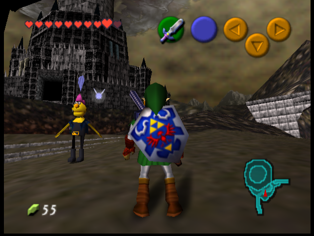

# Merzen der Bauer: Yellow Guy Outfit v2

[Aktueller BPS-Gesamtpatch](Mr_Burns_Mr_Bean_DE_PAL10_Yellow_Guy_Outfit_v2.bps?raw=true) · [Neue Ingame-Bilder](Yellow_Guy_Outfit_v2_Bilder.zip?raw=true) · [Quellen und Prüfungen](Merzen_Yellow_Guy_Outfit_v2_Quellen_Patch_Bilder.zip?raw=true)

Punk-Outfit mit den ursprünglichen Texturfarben; Selbstvorstellung entfernt. Alle bisherigen Änderungen enthalten. Auf unveränderte Europa/PAL-1.0-ROM anwenden. Drei gezielte Szenenproben mit 4 MiB bestanden.

# Merzen der Bauer: Yellow Guy und Wario

[Aktueller BPS-Gesamtpatch](Mr_Burns_Mr_Bean_DE_PAL10_Yellow_Guy_Wario.bps?raw=true) · [Echte Spielbilder](Yellow_Guy_Wario_Bilder.zip?raw=true) · [Quellen und Prüfungen](Merzen_Yellow_Guy_Wario_Quellen_Patch_Bilder.zip?raw=true)

[Dialoge und Sprechweise](Yellow_Guy_Wario_Dialoge.md) · [Prüfbericht](Yellow_Guy_Wario_Beispielbilder/Pruefbericht.md)

Yellow Guy am jungen Schloßweg, Punk vor Ganons Schloß und Wario ausschließlich im jungen Kakariko. Alle bisherigen Änderungen enthalten. Auf unveränderte Europa/PAL-1.0-ROM anwenden. Zehn Szenenproben mit 4 MiB bestanden; vollständiger Durchlauf und Hardwaretest stehen aus.

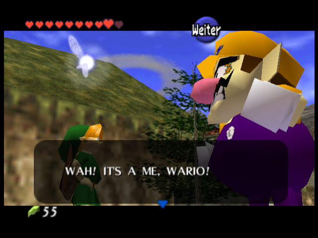

# Merzen der Bauer: Wawario-Brüder und Triangle Guys Gesicht

[Aktueller BPS-Gesamtpatch](Mr_Burns_Mr_Bean_DE_PAL10_Wawario_Bros.bps?raw=true) · [Echte Spielbilder](Wawario_Bros_Bilder.zip?raw=true) · [Quellen und Prüfungen](Merzen_Wawario_Bros_Quellen_Patch_Bilder.zip?raw=true)

[Neue Dialoge](Wawario_Bros_Dialoge.md) · [Prüfbericht](Wawario_Bros_Beispielbilder/Pruefbericht.md)

Alle bisherigen Änderungen enthalten. Auf die unveränderte Europa/PAL-1.0-ROM anwenden. Wawario in der Gerudo-Zelle, Wawaluigi neben dem Zelt; beide nur erwachsen. Triangle Guys Gesicht vervollständigt. Neue Bewohnertexte, Waluigi-Klatsch beim Paar in beiden Zeitebenen und mehr Käsehumor für Wallace. Mit 4 MiB RAM geprüft; kein vollständiger Durchlauf oder Hardwaretest.

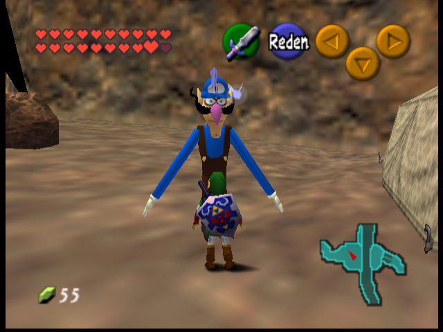

# Merzen der Bauer: Triangle Guy, Brunnenfund und flacher Thaddäus

[Aktueller BPS-Gesamtpatch](Mr_Burns_Mr_Bean_DE_PAL10_Triangle_Brunnen_Morpha.bps?raw=true) · [Echte Spielbilder](Triangle_Brunnen_Morpha_Bilder.zip?raw=true) · [Quellen und Prüfungen](Merzen_Triangle_Brunnen_Morpha_Quellen_Patch_Bilder.zip?raw=true)

[Neue Dialoge](Triangle_Brunnen_Morpha_Dialoge.md) · [Prüfbericht und Morpha-Laufzeitvergleich](Triangle_Brunnen_Morpha_Beispielbilder/Pruefbericht.md)

Alle bisherigen Änderungen enthalten. Auf die unveränderte Europa/PAL-1.0-ROM anwenden. Triangle Guy normal mit A ansprechen; Fundstücke mit Z und C-Up untersuchen. 4 MiB RAM, kein Expansion Pak.

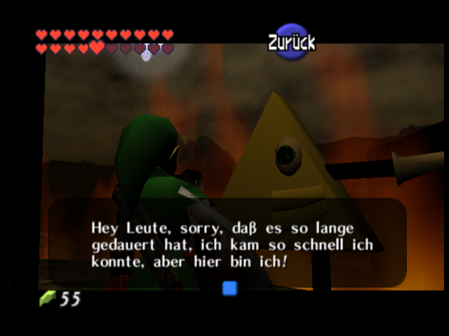

# Merzen der Bauer: Fanboy, Chum Chum, Crocker und leichtere Kämpfe

[Aktueller BPS-Gesamtpatch](Mr_Burns_Mr_Bean_DE_PAL10_Fanboy_ChumChum_Crocker_Kampf.bps?raw=true) · [Bilder](Superhelden_Kampf_Bilder.zip?raw=true) · [Quellen und Prüfungen](Merzen_Superhelden_Kampf_Quellen_Patch_Bilder.zip?raw=true)

[Neue Dialoge](Superhelden_Dialoge.md) · [Prüfbericht](Superhelden_Kampf_Beispielbilder/Pruefbericht.md)

Drei neue Tempel-NPCs, Crocker mit direktem Navi-Konter, Okto-/Forschertexte, halbe Schattenlink-HP und Masterschwert-Onehits bei gültigen Treffern gegen normale Gegner. Alle bisherigen Änderungen enthalten. Auf die unveränderte Europa/PAL-1.0-ROM anwenden.

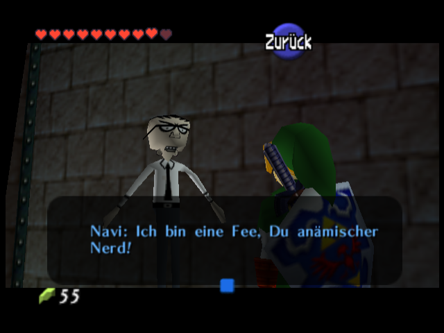

# Merzen der Bauer: Pepsiman im Wassertempel

[Aktueller BPS-Gesamtpatch](Mr_Burns_Mr_Bean_DE_PAL10_Pepsiman_Wassertempel.bps?raw=true) · [Bilder](Pepsiman_Wassertempel_Bilder.zip?raw=true) · [Quellen und Prüfungen](Merzen_Pepsiman_Wassertempel_Quellen_Patch_Bilder.zip?raw=true)

[Neue Dialoge](Pepsiman_Dialoge.md) · [Prüfbericht](Pepsiman_Wassertempel_Beispielbilder/Pruefbericht.md)

Pepsiman als freundlicher Gesprächspartner im Inneren des Wassertempels. Sechs kleine anvisierbare Dosen in fünf Räumen, ohne Kollision; Navi kommentiert den Müll. Alle bisherigen Änderungen enthalten. Auf die unveränderte Europa/PAL-1.0-ROM anwenden.

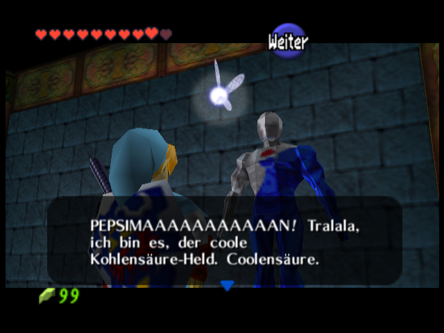

# Merzen der Bauer: Zoras, Eis und Stiefel-Schnellwechsel

[Aktueller BPS-Gesamtpatch](Mr_Burns_Mr_Bean_DE_PAL10_Zoras_Eis_Wasser_Stiefel.bps?raw=true) · [Bilder](Zoras_Eis_Wasser_Stiefel_Bilder.zip?raw=true) · [Quellen und Prüfungen](Merzen_Zoras_Eis_Wasser_Stiefel_Quellen_Patch_Bilder.zip?raw=true)

[Aktuelle Navi-Texte](Navi_Zora_Eis_Wasser_Aktuell.md) · [Neue Dialoge](Zoras_Erwachsen_Dialoge_Aktuell.md) · [Prüfbericht](Zoras_Eis_Wasser_Stiefel_Beispielbilder/Pruefbericht.md)

Steuerkreuz unten schaltet besessene Eisenstiefel als Erwachsener an/aus. Getragene Zora-Tunika in hellem Himmelblau. Alle bisherigen Änderungen enthalten. Auf die unveränderte Europa/PAL-1.0-ROM anwenden.

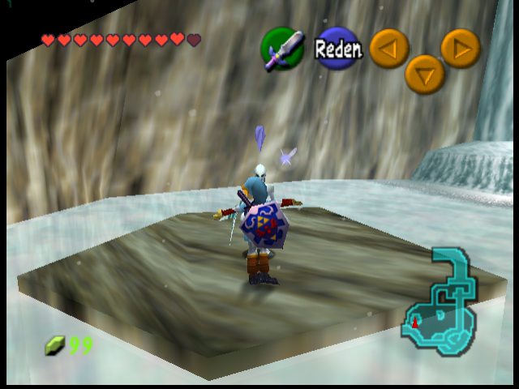

# Merzen der Bauer: Feuertempel, Wallace und Credits-Sitzpose

[Aktueller BPS-Gesamtpatch](Mr_Burns_Mr_Bean_DE_PAL10_Feuertempel_Wallace.bps?raw=true) · [Neue Credits-MP4](Wallace_Weise_Credits_v3.mp4?raw=true) · [Bilder und Video](Feuertempel_Wallace_Bilder_Video.zip?raw=true) · [Quellen und Prüfungen](Merzen_Feuertempel_Wallace_Quellen_Patch_Bilder.zip?raw=true)

[Eingebaute Dialoge](Feuertempel_Wallace_Dialoge_Aktuell.md) · [Prüfbericht](Feuertempel_Wallace_Beispielbilder/Pruefbericht.md)

Auf die unveränderte entpackte Europa/PAL-1.0-ROM in [RomPatcher.js](https://www.marcrobledo.com/RomPatcher.js/) anwenden. Alle bisherigen Änderungen enthalten. Deutsch einstellen; normale Spielstände verwenden.

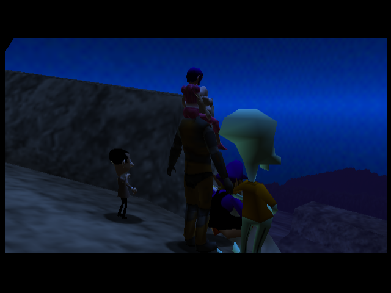

# Merzen der Bauer: Okto und Phantom-Köpfe v2

[Aktueller BPS-Gesamtpatch](Mr_Burns_Mr_Bean_DE_PAL10_Okto_Amthor_v2.bps?raw=true) · [Neue Reveal-MP4](Merz_zu_Amthor_Reveal_v2.mp4?raw=true) · [Bilder und Video](Okto_Amthor_v2_Bilder_Video.zip?raw=true) · [Quellen und Prüfungen](Merzen_Okto_Amthor_v2_Quellen_Patch_Bilder.zip?raw=true)

[Okto-Dialoge](Okto_Wassertempel_Dialoge_Aktuell.md) · [Prüfbericht](Okto_Amthor_v2_Beispielbilder/Pruefbericht.md)

Auf die unveränderte entpackte Europa/PAL-1.0-ROM in [RomPatcher.js](https://www.marcrobledo.com/RomPatcher.js/) anwenden. Alle bisherigen Änderungen enthalten.

# Merzen der Bauer: Amthor, Bean, Darunia und Deku-Baum

**[Aktueller BPS-Gesamtpatch](Mr_Burns_Mr_Bean_DE_PAL10_Amthor_Bean_Darunia_Deku.bps?raw=true)** · [Echte Bilder](Amthor_Bean_Darunia_Deku_Ingame_Bilder.zip?raw=true) · [Quellen und Prüfungen](Merzen_Amthor_Quellen_Patch_Bilder.zip?raw=true)

[Eingebaute Dialoge](Amthor_Bean_Darunia_Deku_Dialoge_Aktuell.md) · [Prüfbericht](Amthor_Bean_Darunia_Deku_Beispielbilder/Pruefbericht.md)

Auf die unveränderte entpackte Europa/PAL-1.0-ROM in [RomPatcher.js](https://www.marcrobledo.com/RomPatcher.js/) anwenden. Alle bisherigen Änderungen enthalten. Deutsch einstellen; normale Spielstände statt alter Save-States verwenden.

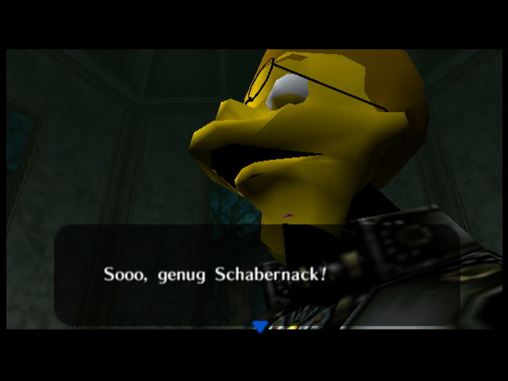

## Vorherige Fassung: Thaddäus, Waluigi und Maskenreaktionen

**[Aktueller BPS-Gesamtpatch](Mr_Burns_Mr_Bean_DE_PAL10_Weise_Masken.bps?raw=true)** · [Echte Bilder](Weise_Masken_Ingame_Bilder.zip?raw=true) · [Quellen und Prüfungen](Merzen_Weise_Masken_Quellen_Patch_Bilder.zip?raw=true)

[Thaddäus-/Waluigi-Dialoge](Thaddaeus_Waluigi_Dialoge_Aktuell.md) · [Maskenreaktionen und Zuordnung](Masken_Reaktionen_Aktuell.md) · [Prüfbericht](Weise_Masken_Beispielbilder/Pruefbericht.md)

Auf die unveränderte entpackte Europa/PAL-1.0-ROM in [RomPatcher.js](https://www.marcrobledo.com/RomPatcher.js/) anwenden. Alle bisherigen Änderungen enthalten. Deutsch einstellen; normale Spielstände statt alter Save-States verwenden.

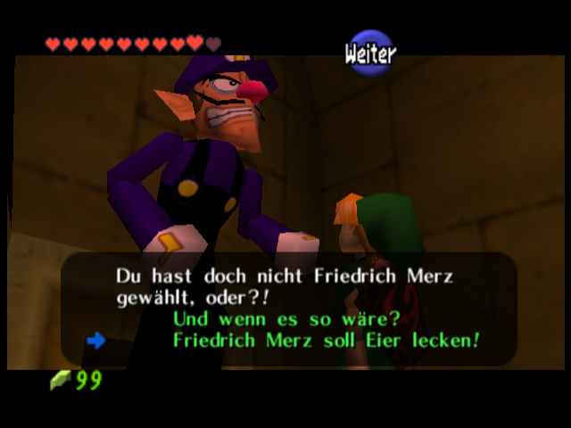

## Vorherige Fassung: Wallace

**[Aktuellen BPS-Gesamtpatch herunterladen](Mr_Burns_Mr_Bean_DE_PAL10_Wallace.bps?raw=true)** · [Echte Ingame-Bilder](Wallace_Ingame_Bilder.zip?raw=true) · [Quellen, Patch und Prüfungen](Merzen_Wallace_Quellen_Patch_Bilder.zip?raw=true) · [Anleitung](Anleitung_Wallace.txt)

[Alle aktuellen Thaddäus-/Waluigi-Dialoge mit IDs und Gesprächsvarianten](Thaddaeus_Waluigi_Dialoge_Aktuell.md).

Wallace steht **nur als Kind** am westlichen Rand des Bombenblumen-Treppenraums in Dodongos Höhle. Normal mit A ansprechen. Er erforscht die Goronen und das extreme Klima und erzählt von Merz' Kohleabbaufiasko. Als Erwachsener fehlt er. 1444 Dreiecke, eigene kleine Kopf-/Armbewegungen, normale Höhlenbeleuchtung und Schatten. Alle bisherigen Modelle und Dialoge enthalten. [Prüfbericht](Wallace_Beispielbilder/Pruefbericht.md).

In [RomPatcher.js](https://www.marcrobledo.com/RomPatcher.js/) auf die **entpackte, unveränderte Europa/PAL-1.0-ROM** anwenden. Original-MD5 `e040de91a74b61e3201db0e2323f768a`. Normale Spielstände verwenden, keine alten Emulator-Save-States.

Text-/ROM-Prüfung, RomPatcher.js-Roundtrip und fünf gezielte Emulatorproben mit tatsächlichen 4 MiB bestanden. Kind/Erwachsener, Wiederansprache, Raum-Fertig-Markierung und echter Tür-Raumwechsel geprüft. Kein vollständiger Spieldurchlauf oder Hardwaretest.

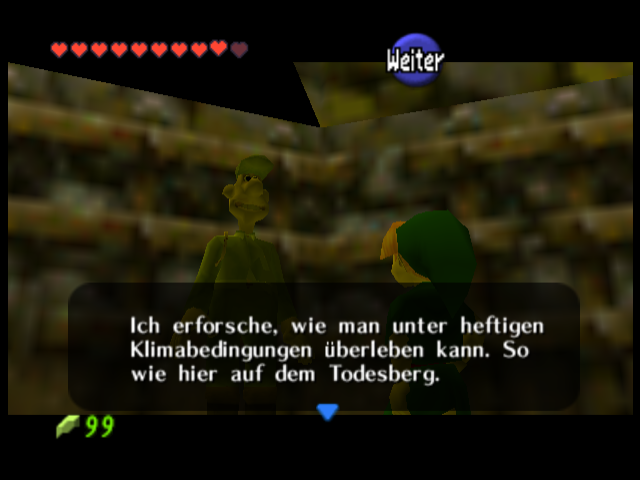

## Vorherige Fassung: Wald, Navi und Salias Reise

**[Vorherigen BPS-Gesamtpatch herunterladen](Mr_Burns_Mr_Bean_DE_PAL10_Wald_Navi_Feuer.bps?raw=true)** · [Ingame-Bilder](Wald_Navi_Feuer_Ingame_Bilder.zip?raw=true) · [Navi-Texte mit Auslösern](Navi_Nach_Waldtempel_bis_Feuer_Aktuell.md) · [Quellen, Patch und Prüfungen](Merzen_Wald_Navi_Feuer_Quellen_Patch_Bilder.zip?raw=true) · [Anleitung](Anleitung_Wald_Navi_Feuer.txt)

Salias Reise-Spruch beim Anruf nach dem Waldtempel ist eingebaut. Außerdem Sheiks Gedicht, Kokiri-Sprüche, der erwachsene Laborforscher mit Papphai und Deine Navi-Fassungen bis nach dem Feuertempel. Alle bisherigen Modelle und Änderungen enthalten. 763 bearbeitete deutsche Nachrichten. [Prüfbericht](Wald_Navi_Feuer_Beispielbilder/Pruefbericht.md).

In [RomPatcher.js](https://www.marcrobledo.com/RomPatcher.js/) auf die **entpackte, unveränderte Europa/PAL-1.0-ROM** anwenden. Original-MD5 `e040de91a74b61e3201db0e2323f768a`. Normale Spielstände verwenden, keine alten Emulator-Save-States.

Text-/ROM-Prüfung, RomPatcher.js-Roundtrip und gezielte 4-MiB-Emulatortests bestanden. Kein vollständiger Spieldurchlauf oder Hardwaretest.

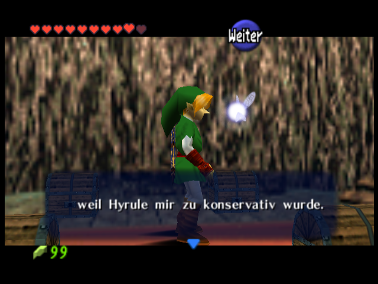

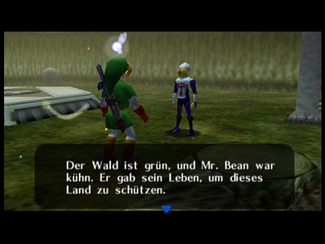

## Vorherige Fassung: Thaddäus und Waluigi als Weise

**[Vorherigen BPS-Gesamtpatch herunterladen](Mr_Burns_Mr_Bean_DE_PAL10_Wasser_Geister_Weise.bps?raw=true)** · [Neue Ingame-Bilder](Wasser_Geister_Weise_Ingame_Bilder.zip?raw=true) · [Quellen, Patch und Prüfungen](Merzen_Wasser_Geister_Weise_Quellen_Patch_Bilder.zip?raw=true) · [Anleitung](Anleitung_Wasser_Geister_Weise.txt)

Thaddäus ersetzt erwachsene Ruto, Waluigi ersetzt Naboru in beiden Zeitabschnitten des Geistertempels. Tempelauftritte, Halle der Weisen, Finale und Credits sind umgestellt, einschließlich der Eisenritter-Enthüllung. Junge Ruto bleibt erhalten. **Neue Dialoge folgen später; jetzt Modelle und Namen.** Tripple T ist etwas größer, schaut in die originale Sproß-Richtung und hat detailliertere Augen. Alle bisherigen Änderungen enthalten. [Prüfbericht](Wasser_Geister_Weise_Beispielbilder/Pruefbericht.md).

In [RomPatcher.js](https://www.marcrobledo.com/RomPatcher.js/) mit der **entpackten, unveränderten Europa/PAL-1.0-ROM** kombinieren. Original-MD5 `e040de91a74b61e3201db0e2323f768a`. Normale Spielstände verwenden, keine alten Emulator-Save-States.

Gezielte Tempel-, Weisen-, Finale-, Credits- und Starttests mit tatsächlichen 4 MiB. RomPatcher.js erzeugt bytegleich die geprüfte Produktions-ROM. Kein vollständiger Spieldurchlauf oder Hardwaretest.

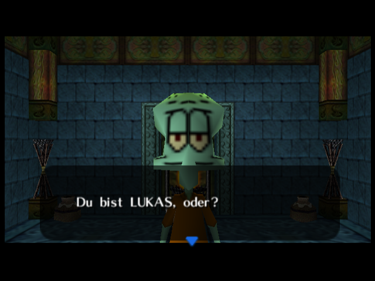

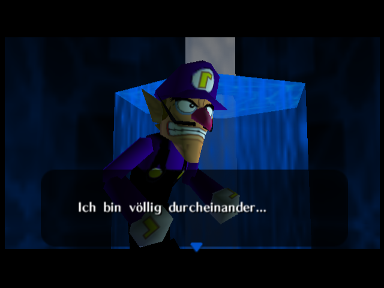

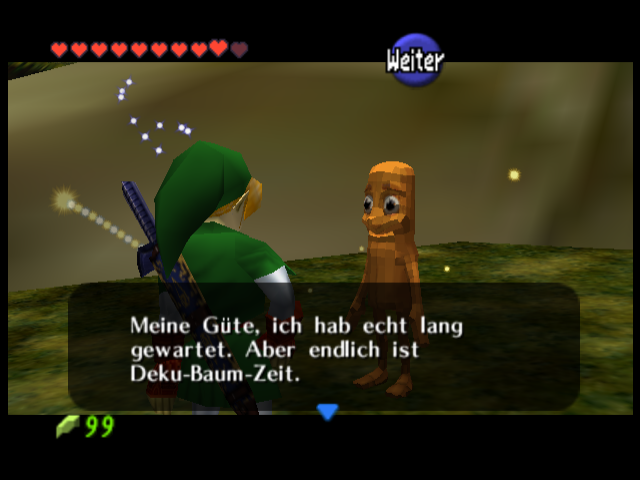

## Vorherige Fassung: Waldtempel, Navi und Tripple T

**[Vorherigen BPS-Gesamtpatch herunterladen](Mr_Burns_Mr_Bean_DE_PAL10_Waldtempel_Sahur.bps?raw=true)** · [Neue Ingame-Bilder](Waldtempel_Sahur_Ingame_Bilder.zip?raw=true) · [Navi-Texte](Navi_Waldtempel_Aktuell.md) · [Quellen, Patch und Prüfungen](Merzen_Waldtempel_Sahur_Quellen_Patch_Bilder.zip?raw=true) · [Anleitung](Anleitung_Waldtempel_Sahur.txt)

Deine Navi-Fassungen, Majoras Maske im inneren westlichen Gang unter dem verdrehten Korridor und Tripple T als Deku-Sproß nach dem Waldamulett. **724 eigene Nachrichten und alle bisherigen Änderungen.** 0120 und feste Lesezeiten bleiben unverändert. Maske mit Z/C-oben untersuchen; kein Einsammel- oder Questgegenstand. [Prüfbericht](Waldtempel_Sahur_Beispielbilder/Pruefbericht.md).

Mit [RomPatcher.js](https://www.marcrobledo.com/RomPatcher.js/) auf die **unveränderte, entpackte Europa/PAL-1.0-ROM** anwenden, nicht auf einen älteren Mod-Patch. Original-MD5 `e040de91a74b61e3201db0e2323f768a`. Normale Spielstände, keine alten Emulator-Save-States.

Start, Dialoge, Anvisieren/Wiederansprache und nativer Waldamulett-/Sproß-Ablauf mit 4 MiB geprüft. RomPatcher.js erzeugt bytegleich die getestete Produktions-ROM. Kein vollständiger Spieldurchlauf oder Hardwaretest.

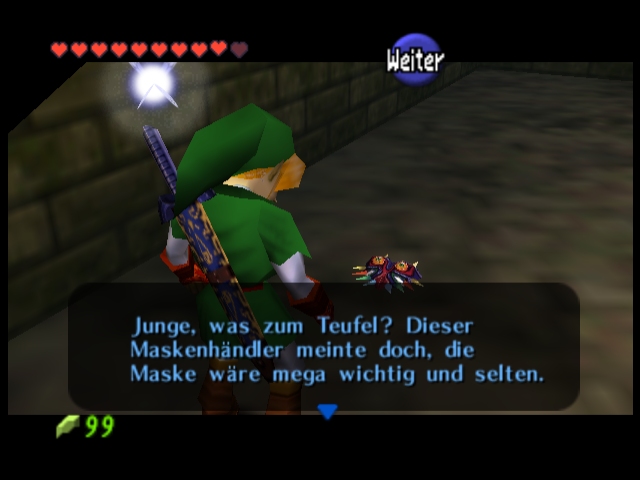

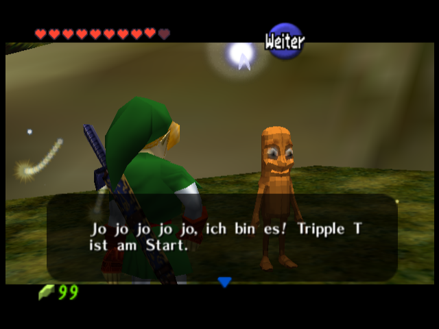

## Vorherige Fassung: Waldweise v2

**[Vorherigen BPS-Gesamtpatch herunterladen](Mr_Burns_Mr_Bean_DE_PAL10_Waldweise_v2.bps?raw=true)** · [Neue Ingame-Bilder und bisheriger Sitz zum Vergleich](Waldweise_v2_Ingame_Bilder.zip?raw=true) · [Anleitung](Anleitung_Waldweise_v2.txt) · [Quellen und Prüfungen](Merzen_Waldweise_v2_Quellen_Patch_Bilder.zip?raw=true)

Die Krabbelminen-Frau sitzt am Schulter-/Halsansatz statt auf Darunias Haarspitze. Angepaßte Beinpose, gleicher Körpermaßstab, seitlicher Blick von hinten in der gemeinsamen Credits-Einstellung. Neuer Dialog: Merz hat Hyrule kaputtgespart, der Laden ist eingestürzt und hat sie erschlagen; sie bittet um eine Warnung in der Vergangenheit. Feste Textzeiten erhalten. **706 eigene Nachrichten, alle bisherigen Änderungen enthalten.** [Prüfbericht samt Normalstart und Speichergrenzen](Waldweise_v2_Beispielbilder/Pruefbericht.md).

Mit [RomPatcher.js](https://www.marcrobledo.com/RomPatcher.js/) auf die **unveränderte, entpackte Europa/PAL-1.0-ROM** anwenden. Original-MD5 `e040de91a74b61e3201db0e2323f768a`. Normale Spielstände verwenden, keine alten Emulator-Save-States.

Aktuelle gezielte 4-MiB-Proben für Credits, Waldamulett, Siegel und regulären Start bestanden. Die vom Nutzer gemeldete Schwarzbild-ROM entspricht exakt der gültigen v1 und startete ebenfalls regulär in beiden getesteten CPU-Modi. Ursache des vorübergehenden Schwarzbilds offen; kein vollständiger Spieldurchlauf oder Hardwaretest.

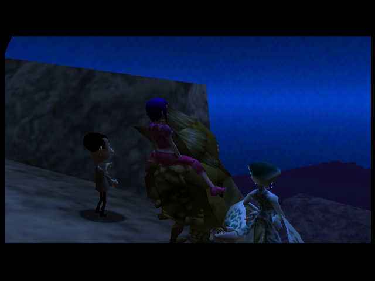

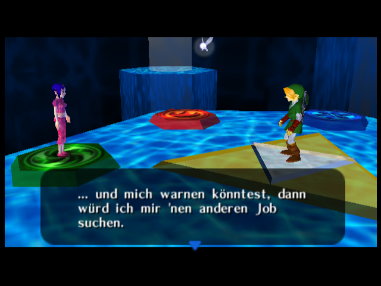

## Vorherige Fassung: Krabbelminen-Frau als Waldweise

**[Vorherigen Waldweisen-Gesamtpatch herunterladen](Mr_Burns_Mr_Bean_DE_PAL10_Waldweise.bps?raw=true)** · [Echte Ingame-Bilder](Waldweise_Ingame_Bilder.zip?raw=true) · [Anleitung](Anleitung_Waldweise.txt) · [Quellen und Prüfungen](Merzen_Waldweise_Quellen_Patch_Bilder.zip?raw=true)

Die Krabbelminen-Frau übernimmt die Waldweisenrolle: Enthüllung nach dem Waldtempel, erwachsene Proportionen und eigene Animationen. In den Credits sitzt sie auf Darunias Schultern. Junge Salia bleibt erhalten. **706 eigene Nachrichten, alle bisherigen Änderungen enthalten.** [Prüfbericht mit Speichergrenzen](Waldweise_Beispielbilder/Pruefbericht.md).

In [RomPatcher.js](https://www.marcrobledo.com/RomPatcher.js/) auf die **unveränderte, entpackte Europa/PAL-1.0-ROM** anwenden. Original-MD5 `e040de91a74b61e3201db0e2323f768a`. Normale Spielstände verwenden, keine alten Emulator-Save-States.

Sieben gezielte Emulatorproben mit ursprünglichen 4 MiB, Text-/ROM-Prüfungen und RomPatcher.js bestanden. Kein vollständiger Spieldurchlauf oder Hardwaretest. Thaddäus ersetzt bisher den Tauchspiel-Leiter; seine Wasserweisenrolle und Naboorus Ersatz durch Waluigi sind noch geplant. Weitere Modelle brauchen jeweils eine neue Speicherprüfung. [Vorprüfung: Waluigi-Modelle und Thaddäus statt Ruto](Waluigi_Modellvergleich.md).

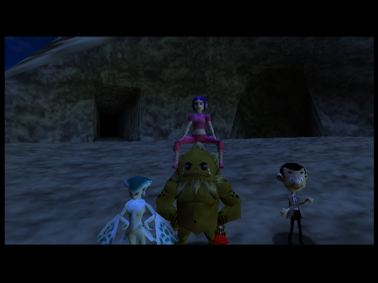

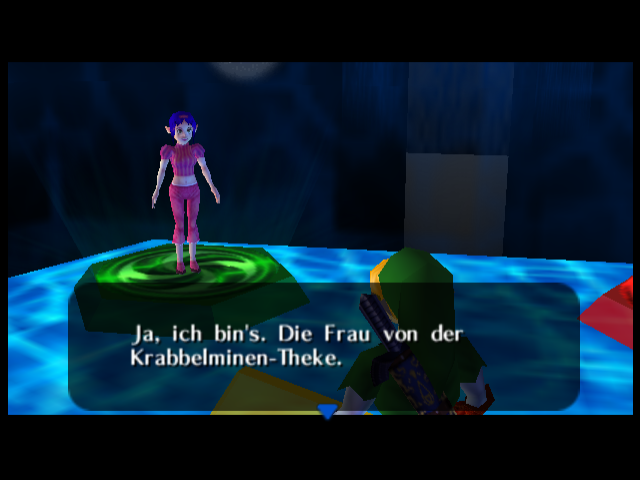

## Vorherige Fassung: Mido in der Zukunft

**[Vorherigen Mido-Gesamtpatch herunterladen](Mr_Burns_Mr_Bean_DE_PAL10_Mido_Zukunft.bps?raw=true)** · [Zwei echte Ingame-Bilder](Mido_Zukunft_Ingame_Bilder.zip?raw=true) · [Anleitung](Anleitung_Mido_Zukunft.txt) · [Quellen und Prüfungen](Merzen_Mido_Zukunft_Quellen_Patch_Bilder.zip?raw=true)

Mido findet den Spieler selbst nach sieben Jahren noch scheiße und hat sich mit König Zora für eine mögliche Siegesfeier nach Friedrich Merz’ Niederlage verabredet. Liedprüfung und Wegfreigabe bleiben unverändert. **698 eigene Nachrichten, alle bisherigen Änderungen enthalten.** [Prüfbericht](Mido_Zukunft_Beispielbilder/Pruefbericht.md).

In [RomPatcher.js](https://www.marcrobledo.com/RomPatcher.js/) auf die **unveränderte, entpackte Europa/PAL-1.0-ROM** anwenden. Original-MD5 `e040de91a74b61e3201db0e2323f768a`. Normale Spielstände verwenden, keine alten Emulator-Save-States.

Native 4-MiB-Gesprächsprobe, Text-/ROM-Prüfungen und RomPatcher.js bestanden. Kein kompletter Dungeon-Durchlauf oder Hardwaretest.

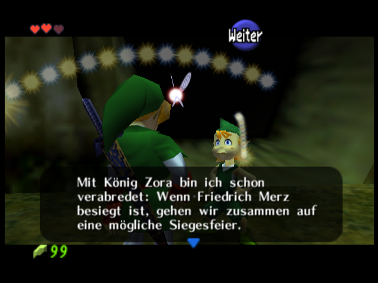

## Vorherige Fassung: Wald-Auftakt

**[Vorherigen Wald-Auftakt-Gesamtpatch herunterladen](Mr_Burns_Mr_Bean_DE_PAL10_Wald_Auftakt.bps?raw=true)** · [Vier echte Ingame-Bilder](Wald_Auftakt_Ingame_Bilder.zip?raw=true) · [Anleitung](Anleitung_Wald_Auftakt.txt) · [Quellen, Patch und Prüfungen](Merzen_Wald_Auftakt_Quellen_Patch_Bilder.zip?raw=true)

Boris ist erst vorgestern gestorben und behauptet, Rennsport und „Uga Paluga“ hätten ihn schon immer ausgezeichnet. Der entspannte Kokiri kommt seit sieben Jahren nicht auf den toten Deku-Baum klar. Shiek deutet eine alte Freundin an. **695 eigene Nachrichten**, alle bisherigen Änderungen einschließlich Okto am Wasser enthalten. [Prüfbericht](Wald_Auftakt_Beispielbilder/Pruefbericht.md).

Waldweise als Krabbelminen-Frau und Phantom-Ganon als Philipp Amthor mit Smithers-Modell sind [für später vorgemerkt](Wald_Auftakt_Beispielbilder/Weitere_Plaene.md); die neuen Modelle sind noch nicht geliefert/eingebaut.

Mit [RomPatcher.js](https://www.marcrobledo.com/RomPatcher.js/) auf die **unveränderte, entpackte Europa/PAL-1.0-ROM** anwenden. Original-MD5 `e040de91a74b61e3201db0e2323f768a`. Normale Spielstände verwenden, keine alten Emulator-Save-States.

Fünf native 4-MiB-Gesprächsproben, sämtliche 1509 ROM-Segmente, Textpuffer/Steuerungen und RomPatcher.js geprüft. Kein kompletter Renn-/Waldtempel-Durchlauf oder Hardwaretest.

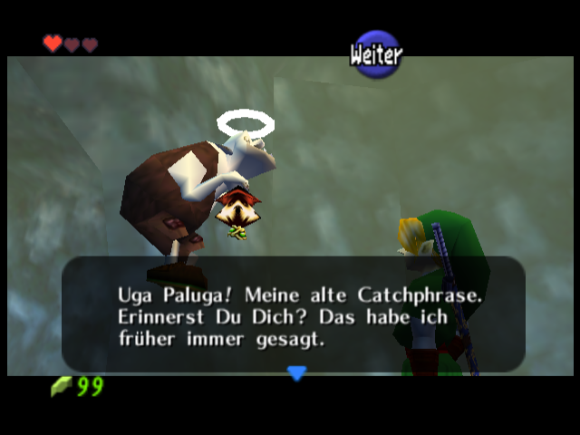

## Vorherige Fassung: Okto am Wasser

**[Vorherigen Okto-Wasser-Gesamtpatch herunterladen](Mr_Burns_Mr_Bean_DE_PAL10_Okto_Wasser.bps?raw=true)** · [Drei echte Ingame-Bilder](Okto_Wasser_Ingame_Bilder.zip?raw=true) · [Anleitung](Anleitung_Okto_Wasser.txt) · [Quellen, Patch und Prüfungen](Merzen_Okto_Wasser_Quellen_Patch_Bilder.zip?raw=true)

Okto schwimmt jetzt am Wasser im Eingangsraum von Jabu-Jabu. Vom trockenen Ufer mit A ansprechen; friedlich und wiederholbar, auch nach geräumtem Raum. Native Wasserringe und Beleuchtung. Alle **682** eigenen Nachrichten sowie alle bisherigen Änderungen enthalten. [Prüfbericht](Okto_Wasser_Beispielbilder/Pruefbericht.md).

Mit [RomPatcher.js](https://www.marcrobledo.com/RomPatcher.js/) auf die **unveränderte, entpackte Europa/PAL-1.0-ROM** anwenden. Original-MD5 `e040de91a74b61e3201db0e2323f768a`. Normale Spielstände verwenden, keine alten Emulator-Save-States.

Zwei gezielte native 4-MiB-Prüfungen, sämtliche 1509 ROM-Segmente, unveränderte Nachrichten und RomPatcher.js geprüft. Kein kompletter Spieldurchlauf oder Hardwaretest.

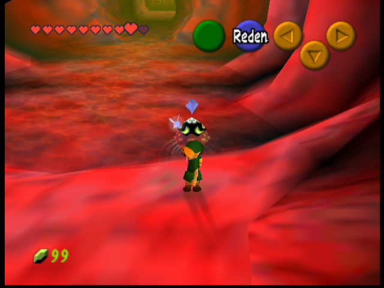

## Vorherige Fassung: Okto, der Oktorok

**[Vorherigen Okto-Gesamtpatch herunterladen](Mr_Burns_Mr_Bean_DE_PAL10_Okto.bps?raw=true)** · [Drei echte Ingame-Bilder](Okto_Ingame_Bilder.zip?raw=true) · [Anleitung](Anleitung_Okto.txt) · [Quellen, Patch und Prüfungen](Merzen_Okto_Quellen_Patch_Bilder.zip?raw=true)

Okto ist ein zusätzlicher friedlicher Oktorok rechts im Eingangsraum von Jabu-Jabu. Mit Z anvisieren und A sprechen; wiederholbar, ohne Angriff und ohne Einfluß auf die Gegnerzahl für den Raumabschluß. Normale Oktoroks und der große Oktorok behalten ihr Verhalten. **682** bearbeitete Nachrichten mit allen bisherigen Änderungen, Modellen und schnellerem Schreibtempo. [Prüfbericht](Okto_Beispielbilder/Pruefbericht.md).

Auf die **unveränderte, entpackte Europa/PAL-1.0-ROM** in [RomPatcher.js](https://www.marcrobledo.com/RomPatcher.js/) anwenden. Original-MD5 `e040de91a74b61e3201db0e2323f768a`. Normale Spielstände verwenden, keine alten Emulator-Save-States.

Vier native 4-MiB-Szenarien, sämtliche Textkontrollen/Puffer, 1509 Segmente und RomPatcher.js geprüft. Kein kompletter Spieldurchlauf oder Hardwaretest.

## Vorherige Fassung: Eule und Tagesdialoge

**[Vorherigen Eule-/Tagesdialog-Gesamtpatch herunterladen](Mr_Burns_Mr_Bean_DE_PAL10_Eule_Tagesdialoge.bps?raw=true)** · [Sieben echte Ingame-Bilder](Eule_Tagesdialoge_Ingame_Bilder.zip?raw=true) · [Anleitung](Anleitung_Eule_Tagesdialoge.txt) · [Quellen, Patch und Prüfungen](Merzen_Eule_Tagesdialoge_Quellen_Patch_Bilder.zip?raw=true)

Alle 34 Euleneinträge geprüft; an 33 Stellen mehr Abwägungen, Selbstkorrekturen und Energie-/Wirtschaftsvergleiche, ohne Identitätsenthüllung. Die beiden Gags zu Zitteraalen und Bean als Rettungssanitäter nun bei zwei leicht erreichbaren Tagesbewohnern des Marktplatzes, in Erst-/Wiederholungsgesprächen und nach Zeldas Flucht. Nachtwache bekommt einen eigenen Dienstspruch. Merz nennt Bean nun „Herr Bohne“. Weiterhin **681** bearbeitete Nachrichten, sämtliche bisherigen Modelle und schnelleres Schreibtempo enthalten. [Belegung und Prüfbericht](Eule_Tagesdialoge_Beispielbilder/Pruefbericht.md).

Auf die **unveränderte, entpackte Europa/PAL-1.0-ROM** in [RomPatcher.js](https://www.marcrobledo.com/RomPatcher.js/) anwenden. Original-MD5 `e040de91a74b61e3201db0e2323f768a`. Normale Spielstände verwenden, keine alten Emulator-Save-States.

Neun gezielte native 4-MiB-Szenarien, Textkontrollen/Puffer, 1509 Segmente und RomPatcher.js geprüft. Nicht jeder Eulenauftritt live gespielt, kein kompletter Spieldurchlauf oder Hardwaretest.

## Vorherige Fassung: eigene NPC- und Händlerstimmen

**[Vorherigen NPC-Stimmen-Gesamtpatch herunterladen](Mr_Burns_Mr_Bean_DE_PAL10_NPC_Stimmen.bps?raw=true)** · [Neun echte Ingame-Bilder](NPC_Stimmen_Ingame_Bilder.zip?raw=true) · [Anleitung](Anleitung_NPC_Stimmen.txt) · [Quellen, Patch und Prüfungen](Merzen_NPC_Stimmen_Quellen_Patch_Bilder.zip?raw=true)

Neue Nutzerideen auf passende Händler und Bewohner verteilt. 46 zusätzliche Nachrichtenzustände, insgesamt **681**; 634 bisherige eigene Texte bytegleich, ein Kokiri-Text neu gefaßt. Sämtliche bisherigen Modelle, schnelleres Schreibtempo und normaler Spielstart enthalten. [Belegung und Prüfbericht](NPC_Stimmen_Beispielbilder/Pruefbericht.md).

Auf die **unveränderte, entpackte Europa/PAL-1.0-ROM** in [RomPatcher.js](https://www.marcrobledo.com/RomPatcher.js/) anwenden. Original-MD5 `e040de91a74b61e3201db0e2323f768a`. Normale Spielstände verwenden, keine alten Emulator-Save-States.

16 gezielte native 4-MiB-Szenarien, Textkontrollen/Puffer, 1509 Segmente und RomPatcher.js geprüft. Kein kompletter Spieldurchlauf oder Hardwaretest.

## Vorherige Fassung: weitere Alltagsgags in Hyrule und Kakariko

**[Vorherigen Alltagsgags-Gesamtpatch herunterladen](Mr_Burns_Mr_Bean_DE_PAL10_Hyrule_Kakariko_Gags.bps?raw=true)** · [Sechs echte Ingame-Bilder](Hyrule_Kakariko_Gags_Ingame_Bilder.zip?raw=true) · [Anleitung](Anleitung_Hyrule_Kakariko_Gags.txt) · [Quellen, Patch und Prüfungen](Merzen_Hyrule_Kakariko_Gags_Quellen_Patch_Bilder.zip?raw=true)

Alle sechs neuen Nutzerideen auf zuvor originale NPC-Gespräche verteilt, einschließlich der vier nachgereichten Ideen. Neun Nachrichtenzustände überarbeitet; alle vorherigen 626 eigenen Texte erhalten, insgesamt **635**. Sämtliche bisherigen Modelle und das schnellere Schreibtempo enthalten; normaler Spielstart. [Belegung und Prüfbericht](Hyrule_Kakariko_Gags_Beispielbilder/Pruefbericht.md).

Auf die **unveränderte, entpackte Europa/PAL-1.0-ROM** in [RomPatcher.js](https://www.marcrobledo.com/RomPatcher.js/) anwenden. Original-MD5 `e040de91a74b61e3201db0e2323f768a`. Normale Spielstände verwenden, keine alten Emulator-Save-States.

Sechs gezielte native Gespräche bei 4 MiB, sämtliche Textkontrollen/Puffer, 1509 Segmente und RomPatcher.js geprüft. Kein kompletter Spieldurchlauf oder Hardwaretest.

## Vorherige Fassung: mehr Gespräche in Hyrule-Stadt

**[Vorherigen Hyrule-NPC-Gesamtpatch herunterladen](Mr_Burns_Mr_Bean_DE_PAL10_Hyrule_NPCs.bps?raw=true)** · **[Vier echte Ingame-Beispiele](Hyrule_NPCs_Ingame_Bilder.zip?raw=true)** · [Anleitung](Anleitung_Hyrule_NPCs.txt) · [Quellen, Patch und Prüfnachweise](Merzen_Hyrule_NPCs_Quellen_Patch_Bilder.zip?raw=true)

27 bisher originale Nachrichten bei Stadtbewohnern und in den Seitengassen ersetzt. Dazu den bestehenden Farm-Folgedialog der Frau um den ausdrücklich gewünschten Gesichts-Gag erweitert. Neue Nutzerideen und zusätzliche Überraschungen verteilt, bisherige Nutzertexte erhalten. Insgesamt **626 bearbeitete deutsche Nachrichten**. Alle bisherigen Modelle, Kapitel und das schnellere Schreibtempo enthalten; normaler Spielstart.

Die Frau steht am Originalplatz, und die normale Marktplatzkamera hält die Ansicht auf Abstand. Ihr Farmhinweis bleibt als Fortsetzung erhalten. Hundesuche, Flaschenhandel, Preise, Belohnungen und feste Cutscene-Zeiten behalten ihre Regeln. [Belegung und Prüfbericht](Hyrule_NPCs_Beispielbilder/Pruefbericht.md).

Den Gesamtpatch in [RomPatcher.js](https://www.marcrobledo.com/RomPatcher.js/) auf die **unveränderte, entpackte Europa/PAL-1.0-ROM** anwenden. Original-MD5: `e040de91a74b61e3201db0e2323f768a`. Normale Spielstände verwenden, keine alten Emulator-Save-States.

28 geänderte deutsche Nachrichten gegen die Vorfassung nachgewiesen; übrige Texte und Spiellogik erhalten. Textkontrollen, Breiten, Puffer, 1509 Segmente, sieben gezielte 4-MB-Szenarien und RomPatcher.js geprüft. Kein vollständiger Spieldurchlauf oder Hardwaretest.

## Vorherige Fassung: schnelleres Texttempo

**[Vorherigen Texttempo-Gesamtpatch herunterladen](Mr_Burns_Mr_Bean_DE_PAL10_Texttempo.bps?raw=true)** · [Anleitung](Anleitung_Texttempo.txt) · [Prüfbericht](Texttempo_Pruefung/Pruefbericht.md) · [Quellen, Patch und Prüfnachweise](Merzen_Texttempo_Quellen_Patch_Pruefung.zip?raw=true)

Normale deutsche Textboxen zeigen ihre Buchstaben ungefähr doppelt so schnell. Jede Seite wartet weiterhin auf Deinen Tastendruck. Feste Textzeiten, Auswahlfragen, Cutscenes und Spezialsteuerungen behalten das bisherige Verhalten. A und B bleiben wie bisher belegt. Alle bisherigen Modelle und 599 bearbeiteten Dialoge enthalten, normaler Spielstart.

Den Gesamtpatch in [RomPatcher.js](https://www.marcrobledo.com/RomPatcher.js/) auf die **unveränderte, entpackte Europa/PAL-1.0-ROM** anwenden. Original-MD5: `e040de91a74b61e3201db0e2323f768a`. Nicht auf eine bereits gepatchte Mod anwenden. Normale Spielstände verwenden, keine alten Emulator-Save-States. Der ältere separate Nach-Jabu-Testpatch wird dadurch nicht geändert.

Vorher/Nachher mit derselben Dialogsituation bei 4 MiB gemessen. Englische Gegenprobe, native Auswahlfrage und automatischer Merz-Text behalten den beobachteten Ablauf. Alle 2115 deutschen ROM-Nachrichten bytegleich, sämtliche Textkontrollen, Puffer und 1509 Segmente geprüft; BPS mit RomPatcher.js erfolgreich gegen die Original-ROM validiert. Kein kompletter Spieldurchlauf oder Hardwaretest.

## Vorherige Fassung: Zoras über Musik und Mido

**[Vorherigen Zora-Gesamtpatch herunterladen](Mr_Burns_Mr_Bean_DE_PAL10_Zora_Gags.bps?raw=true)** · **[Zwei echte Ingame-Bilder](Zora_Gags_Ingame_Bilder.zip?raw=true)** · [Quellen, Patch und Prüfnachweise](Merzen_Zora_Gags_Quellen_Patch_Bilder.zip?raw=true)

Zwei schwächere Ergänzungen ersetzt: Der Tierarzt-Dialog und mein allgemeiner Ruto-Nachtrag weichen den neuen Nutzerideen. Ein Zora bemerkt die für eine Sekunde sau crazy klingende Musik beim Verlassen der Höhle. Ein anderer kennt Mido, nennt ihn einen Wichser und erzählt, wie Mido ihm das Schwimmen erklären wollte – einem Zora. Beide Einträge sind nach Erhalt des Zora-Saphirs verfügbar. Die nativen Zora-Gruppen teilen diese zwei Nach-Jabu-Nachrichten wie bisher.

Genau zwei deutsche Texte geändert; alle anderen Nutzerideen und die neuen Navi-Roasts bleiben enthalten. Weiterhin **599 deutsche Nachrichten**, alte Rechtschreibung und normale Seitenzahlen. Keine Änderungen an Musikdaten, Figuren oder Kampflogik.

Den normalen Gesamtpatch direkt auf die **unveränderte, entpackte Europa/PAL-1.0-ROM** in [RomPatcher.js](https://www.marcrobledo.com/RomPatcher.js/) anwenden. Original-MD5: `e040de91a74b61e3201db0e2323f768a`. Nicht auf eine vorherige Mod anwenden. Normale Spielstände statt alter Emulator-Save-States verwenden. Normaler Spielstart und alle bisherigen Änderungen enthalten.

Zwei native Gesprächspartner nach Jabu-Jabu und englische Gegenprobe mit derselben Produktions-ROM bei 4 MB geprüft. Nur Link wird für die Aufnahmen aufgestellt; NPCs bleiben am Originalplatz. ROM-Nachrichtentabellen, alle Textkontrollen und Puffer, 1509 Segmente und RomPatcher.js geprüft. Kein kompletter Spieldurchlauf oder Hardwaretest. [Prüfbericht](Zora_Gags_Beispielbilder/Pruefbericht.md).

## Vorherige Fassung: Navi beleidigt die Gegner

**[Vorherigen Navi-Gesamtpatch herunterladen](Mr_Burns_Mr_Bean_DE_PAL10_Navi_Roasts.bps?raw=true)** · **[Echte Ingame-Bilder](Navi_Gegner_Roasts_Ingame_Bilder.zip?raw=true)** · [Alle 93 Texte lesen](Navi_Gegner_Roasts_Alle_Texte.txt) · [Quellen, Patch und Prüfnachweise](Merzen_Navi_Roasts_Quellen_Patch_Bilder.zip?raw=true)

Alle 93 Navi-Zieltextplätze wurden neu geschrieben: direktes Beschimpfen über die tatsächlichen Aktionen der Gegner, deutlich derber und nicht überall mit Flüchen. Skulltula: „Du achtbeiniger Vollidiot! Dreh Dich ruhig um und zeig uns Deinen Schwachpunkt. Ja, genau so. Meine Fresse.“ Killermuschel: „Mach die Fresse noch einmal auf! Ich brech' diese Scheißmuschel in der Mitte durch, ich schwör's Dir!“ Alte Rechtschreibung, alle bisherigen Seitenzahlen und festen Zeiten bleiben erhalten. Insgesamt **599 deutsche Nachrichten** und alle bisherigen Modelle und Dialogkapitel enthalten.

Den normalen Gesamtpatch direkt mit der **unveränderten, entpackten Europa/PAL-1.0-ROM** in [RomPatcher.js](https://www.marcrobledo.com/RomPatcher.js/) kombinieren. Original-MD5: `e040de91a74b61e3201db0e2323f768a`. Nicht auf eine vorherige Mod anwenden. Normale Spielstände statt alter Emulator-Save-States verwenden. Diese normale Fassung hat den normalen Spielstart; der separate Nach-Jabu-Testpatch steht weiter unten.

ROM-Vergleich: genau diese 93 deutschen Nachrichtentexte geändert; übrige Nachrichten, Modelle, Räume und ausführbarer Code erhalten. Nur deutsche Textzeiger müssen auf die neuen Textlängen zeigen. Build, 599 Kontrollsequenzen, Seitenzahlen, Textpuffer, 1509 Segmente und RomPatcher.js geprüft. Drei gezielte 4-MB-Laufzeitprüfungen: native Skulltula, native Killermuschel und englische Gegenprobe. Kein Live-Test aller 93 Plätze oder kompletter Spieldurchlauf. [Prüfbericht](Navi_Gegner_Roasts_Beispielbilder/Pruefbericht.md).

## Vorherige Fassung: LEGO X-Wing im Schattentempel

## Separater Sonderpatch: Start nach Jabu-Jabu (X-Wing-Fassung)

**[Sonderpatch herunterladen](Sonderpatch_Nach_Jabu_Jabu_DE_PAL10.bps?raw=true)** · [Anleitung](Sonderpatch_Nach_Jabu_Jabu_Anleitung.txt) · [Vergleichsbilder, Quellenänderung und Prüfung](Sonderpatch_Nach_Jabu_Jabu_Pruefung_Bilder.zip?raw=true)

Zum Prüfen der Fluchtszene und der Wache: auf die unveränderte Original-PAL-1.0-ROM patchen und **einen neuen Spielstand anlegen**. Start als Kind in Zoras Quelle nach Jabu-Jabu, drei Steine und sechs Herzen; Zeldas Flucht ist noch offen. Regulär nach Hyrule laufen und das Stadttor anlaufen. Alle bisherigen Änderungen einschließlich X-Wing enthalten. Diese Sonderfassung verändert den Startfortschritt, keine Grafik- oder Beleuchtungsregeln. Der aktuelle normale Gesamtpatch steht oben.

Im neu angelegten Testspiel wurde die Flucht durch normales Laufen am Stadttor ausgelöst und wird auf dem Cloud-Renderer sichtbar gezeichnet. Die alte starke Abdunklung bei einem direkten Cutscene-Teststart war kein verläßlicher visueller Nachweis. Die genaue Initialisierungs-/Renderer-Ursache bleibt offen. Der schmale schwarze Strich bei der Krugwache erscheint auch in Vanilla; bei gleicher Kamera ist der geprüfte Wandbereich pixelgleich. [Original](Sonderpatch_Nach_Jabu_Jabu_Bilder/Wache_Original.png) · [Sonderpatch](Sonderpatch_Nach_Jabu_Jabu_Bilder/Wache_Sonderpatch.png).

**[Vorherigen X-Wing-Gesamtpatch herunterladen](Mr_Burns_Mr_Bean_DE_PAL10_Lego_XWing.bps?raw=true)** · **[Drei echte Spielbilder als ZIP](Lego_XWing_Ingame_Bilder.zip?raw=true)** · [Quellen, Patch und Prüfnachweise](Merzen_Lego_XWing_Quellen_Patch_Bilder.zip?raw=true)

Ein kleiner LEGO X-Wing liegt im freien Seitengang des ersten Schädelraums im Schattentempel. Spannweite 24 Spieleinheiten, passend als Spielzeug für Link, mit einheitlichen Proportionen und Szenenbeleuchtung. Der Mann im blauen Hemd unten im erwachsenen Kakariko sagt: „Scheiße, ich hab' meinen Lego X-Wing im Schattentempel liegen lassen!“ Danach folgt auf der vorhandenen zweiten Seite ein Bauanleitungs-Gag. Der Satz bleibt nach dem Schattenamulett verfügbar. Insgesamt **599 deutsche Nachrichten**; alle bisherigen Modelle und Dialogkapitel enthalten.

**Der Bewohner ist unten im Dorf direkt erreichbar.** Er und der Dachbewohner bleiben auf ihren Originalplätzen, auch für die Aufnahmen. Nur Link wird für die gezielten Tests aufgestellt. Normale Spielkamera, unbearbeitete Bilder.

Den Gesamtpatch direkt mit der **unveränderten, entpackten Europa/PAL-1.0-ROM** in [RomPatcher.js](https://www.marcrobledo.com/RomPatcher.js/) kombinieren. Original-MD5: `e040de91a74b61e3201db0e2323f768a`. Nicht auf eine vorherige Mod anwenden. Normale Spielstände verwenden; ältere Emulator-Save-States enthalten alte Daten. Keine vollständige ROM enthalten.

Build, alle 599 Textkontrollsequenzen, 1509 Segmente und RomPatcher.js-Rundlauf geprüft. Fünf gezielte 4-MB-Laufzeitprüfungen: zwei Modellansichten, deutscher Dialog vor/nach Schattenamulett und englische Gegenprobe. Kein vollständiger Dungeon-/Spieldurchlauf oder Hardwaretest. [Prüfbericht](Lego_XWing_Beispielbilder/Pruefbericht.md) · [Prüfsummen](SHA256SUMS_Lego_XWing.txt).

## Vorherige Fassung: Nintendo 64 in Jabu-Jabu

**[Vorherigen Nintendo-64-Gesamtpatch herunterladen](Mr_Burns_Mr_Bean_DE_PAL10_N64_in_Jabu.bps?raw=true)** · **[Drei echte Ingame-Bilder als ZIP](N64_in_Jabu_Ingame_Bilder.zip?raw=true)** · [Quellen, Patch und Prüfnachweise](Merzen_N64_in_Jabu_Quellen_Patch_Bilder.zip?raw=true)

Auf der unteren Plattform bei Rutos erstem Sturz steht ein kleiner Nintendo 64 samt Ocarina-of-Time-Kassette, Controller und Kabel. Das Gehäuse ist 10 Spieleinheiten breit, passend für Kinder-Link. Z anvisieren und C-oben drücken: Navi sagt „Ein Nintendo 64 mit Zelda Ocarina of Time... Ich tu mal so, als hätte ich das nicht gesehen.“ Der Kommentar ist wiederholbar. Gleichmäßige Proportionen und Szenenbeleuchtung. Insgesamt **597 deutsche Nachrichten**, alle bisherigen Modelle und Dialogkapitel enthalten.

Den Gesamtpatch direkt mit der **unveränderten, entpackten Europa/PAL-1.0-ROM** in [RomPatcher.js](https://www.marcrobledo.com/RomPatcher.js/) kombinieren. Original-MD5: `e040de91a74b61e3201db0e2323f768a`. Nicht auf eine vorherige Mod anwenden. Normale Spielstände verwenden; ältere Emulator-Save-States enthalten alte Daten. Keine vollständige ROM enthalten.

Build, alle 597 Textkontrollsequenzen, 1509 komprimierte Segmente und RomPatcher.js-Rundlauf geprüft. Vier gezielte 4-MB-Laufzeittests bestätigen wiederholten Kommentar, seitliche Größenprobe, englische Sprache und einen anderen Raum. Die neue Konsole ist nur in der deutschen Mod aktiv. Kein vollständiger Dungeon-/Spieldurchlauf oder Hardwaretest. Teststart-Hilfen und Grenzen stehen im [Prüfbericht](N64_in_Jabu_Beispielbilder/Pruefbericht.md). [Prüfsummen](SHA256SUMS_N64_in_Jabu.txt).

## Vorherige Fassung: Habeck in der Halle der Weisen

**[Vorherigen Habeck-Gesamtpatch herunterladen](Mr_Burns_Mr_Bean_DE_PAL10_Habeck_Rauru.bps?raw=true)** · **[Acht ausgewählte Ingame-Bilder als ZIP](Habeck_Rauru_Ingame_Bilder.zip?raw=true)** · [Quellen, Patch und Prüfnachweise](Merzen_Habeck_Rauru_Quellen_Patch_Bilder.zip?raw=true)

Robert Habeck ersetzt Rauru mit dem gelieferten Avatar: 2341 Dreiecke, 24 Hauptgelenke, eigene Proportionen, einheitliche Gesamtgröße und Szenenlicht. Seine ausführliche Erklärung verbindet Geistereule, Stasis, Energieversorgung und Zeitreise. Im jungen Kakariko berichtet der Dachbewohner vom beobachteten Sturz; der eigentliche Aussichtsturm-NPC existiert dort erst beim erwachsenen Link. 14 Nachrichten dieses Kapitels, insgesamt 596 deutsche Nachrichten in alter Rechtschreibung. Alle bisherigen Modelle und Dialogkapitel enthalten.

Die Rede verwendet sichere Textfortsetzungen und weitere manuell weitergeschaltete Seiten. Bestehende feste Text-/Kamerazeiten bleiben erhalten. Ja/Nein samt Rücksprung, Lichtamulett und native Rückkehr bleiben bestehen. Das ganze Gespräch wurde ab der tatsächlichen Masterschwert-Aufnahme bis zum Lichtamulett und Navis Dialog nach der Rückkehr mit 4 MB geprüft. Der Zeuge wurde tags/nachts sowie mit Erwachsenen- und Englisch-Gegenproben getestet. Für seine Aufnahme wird nur im Test die Figur zum Spieler versetzt; in der Mod bleibt sie auf dem Dach. Kein kompletter Spieldurchlauf, keine Hardwareprüfung und keine Prüfung jedes späteren Weisen-Auftritts. [Prüfbericht](Habeck_Rauru_Dialogbeispiele/Pruefbericht.md).

Den Patch direkt mit der **unveränderten, entpackten Europa/PAL-1.0-ROM** in [RomPatcher.js](https://www.marcrobledo.com/RomPatcher.js/) kombinieren. Original-MD5: `e040de91a74b61e3201db0e2323f768a`. Nicht auf eine vorherige Mod anwenden. Normale Spielstände verwenden; ältere Emulator-Save-States enthalten alte Daten. Keine vollständige ROM enthalten.

## Ausgewählte neue Aufnahmen

## Frühere Veröffentlichungen

### Drei Steine, Flucht und Masterschwert

**[Vorherigen Zeitübergang-Patch herunterladen](Mr_Burns_Mr_Bean_DE_PAL10_Zeituebergang.bps?raw=true)** · **[12 ausgewählte Ingame-Bilder als ZIP](Zeituebergang_Ingame_Bilder.zip?raw=true)** · [Quellen, Patch und Prüfnachweise](Merzen_Zeituebergang_Quellen_Patch_Bilder.zip?raw=true)

22 Nachrichten für Merz bei der Flucht und nach dem Masterschwert, Soldaten, neue Marktreaktionen und Navi. Insgesamt 584 bearbeitete deutsche Nachrichten in alter Rechtschreibung. Alle bisherigen Modelle und Dialogkapitel enthalten. Feste bestehende Textzeiten bleiben erhalten. Navis neuer Kommentar erscheint nach dem Masterschwert bei einer natürlichen Guide-Gelegenheit und wird als gehört gespeichert.

Den Patch direkt mit der **unveränderten, entpackten Europa/PAL-1.0-ROM** in [RomPatcher.js](https://www.marcrobledo.com/RomPatcher.js/) kombinieren. Original-MD5: `e040de91a74b61e3201db0e2323f768a`. Nicht auf eine vorherige Mod anwenden. Normale Spielstände verwenden; alte Emulator-Save-States können alte Daten enthalten. Keine vollständige ROM enthalten.

Build, alle 584 Steuersequenzen, 1509 komprimierte Segmente und RomPatcher.js-Rundlauf geprüft. Gezielte 4-MB-Laufzeittests: Flucht bis Abschluß, tatsächliches Ziehen des Masterschwerts, Soldaten, Markt vor/nach der Flucht, Navi einmalig samt Sprach-/Alters-Gegenprüfung. Kein kompletter Spieldurchlauf und keine N64-Hardwareprüfung. Die Fluchtaufnahme ist im direkten Cloud-Teststart auffällig dunkel; gleicher Befund in Vanilla, Ursache noch offen. Vergleich und Grenzen im [Prüfbericht](Zeituebergang_Dialogbeispiele/Pruefbericht.md).

## Ausgewählte neue Aufnahmen

## Frühere Veröffentlichung und Grafikprüfung

### Zoras, Jabu-Jabu und Navi-Roasts

**[Vorherigen Zora-/Jabu-Patch herunterladen](Mr_Burns_Mr_Bean_DE_PAL10_Zoras_Jabu_Navi.bps?raw=true)** · **[Sieben neue Ingame-Bilder als ZIP](Zoras_Jabu_Navi_Ingame_Bilder.zip?raw=true)** · [Quellen, Patch und Prüfberichte](Merzen_Zoras_Jabu_Quellen_Patch_Bilder.zip?raw=true)

König Zora hat Merz den Saphir für Klimaanlagen versprochen. Ruto versteckt sich im Wal und verschwindet nach der Übergabe tatsächlich aus dem Thronsaal. Neue Flaschenpost, Rockmusik und Zora-Selbstfindung, Erbsen-Scalper, Navi-Reaktionen und Jabu-spezifische Händler-/Kartenmeldung. Barinade begrüßt den Spieler vor dem Kampf mit einer neuen, frei weiterklickbaren Box. Dazu alle 93 Navi-Zieltextplätze als individuelle Roasts. Insgesamt 564 deutsche Nachrichten in alter Rechtschreibung.

Der Nachspiel-Kommentar von Navi benötigt den erhaltenen Saphir und gilt vor Zeldas Flucht. Ihre normale C-Up-Verfügbarkeit und Abklingzeit bleiben erhalten. Bestehende feste Textzeiten, Preise, Gegenstände, Dungeon-Ereignisse und Kampfphasen bleiben erhalten; nur die neue Barinade-Box hält den Intro-Abschluß bis zum Weiterklicken an. Bean- und Thaddäus-Modelldaten sind unverändert. Alle früheren Änderungen sind enthalten.

Den Patch direkt mit der **unveränderten, entpackten Europa/PAL-1.0-ROM** in [RomPatcher.js](https://www.marcrobledo.com/RomPatcher.js/) kombinieren. Original-MD5: `e040de91a74b61e3201db0e2323f768a`. Nicht auf eine vorherige Mod anwenden. Normale Spielstände verwenden; alte Emulator-Save-States enthalten alte Daten. Keine vollständige ROM enthalten.

Build, Textpuffer, native Steuerzeichen, alle 1509 gepackten Segmente und RomPatcher.js-Rundlauf geprüft. Gezielte 4-MB-Szenarien für König, Navi vor/nach dem Saphir, Barinade samt Kampffreigabe, Erbsenkauf, Karten-Gegenprüfung und Z-Target/C-Up-Roast bestanden. Teststart und Positionierung sind Hilfen, die Kartenprüfung ruft den Nachrichteneinstieg direkt auf. Kein vollständiger Dungeon-/Spieldurchlauf und keine echte N64-Hardware geprüft. Details im Quellenarchiv: TESTING_ZORAS_JABU.md.

## Grafikprüfung vom 19.10.2026

[15 Vergleichsbilder und Bericht](Grafikpruefung_2026-10-19/) · **[Bilder als ZIP](Grafikpruefung_2026-10-19.zip?raw=true)**

Fehlende Wandflächen beim Händler und in der Halle kamen im geprüften Cloud-Aufbau von abgeschaltetem GLideN64-Software-Clipping. Mit `EnableClipping=True` werden sie bei gleicher Kamera gezeichnet. Die frühere gegenteilige Empfehlung war falsch. Bowling-Hintergrund, Navis Abdunklung und offene Hofränder wurden auch im Original geprüft. Das aktuelle Händler-Beispielbild ist ersetzt; der BPS ist unverändert.

## Ausgewählte Ingame-Bilder

## Frühere Downloads

Die bisherigen Dateien bleiben erhalten.

# Merzen der Bauer: Thaddäus beim Tauchspiel

**[Neuen BPS-Patch herunterladen](Mr_Burns_Mr_Bean_DE_PAL10_Thaddaeus.bps?raw=true)** · **[Fünf Ingame-Bilder als ZIP](Thaddaeus_Ingame_Bilder.zip?raw=true)** · [Quellen, Patch und Bilder](Merzen_Thaddaeus_Quellen_Patch_Bilder.zip?raw=true)

Der Tauchspiel-Leiter ist jetzt Thaddäus. Verwendet wird die bereitgestellte SuperSponge-Version mit 254 Dreiecken und ihrem eigenen Rig mit 27 Gelenken. Originalproportionen und starre Gewichte bleiben erhalten, alle drei Achsen werden gleichmäßig skaliert. Zehn neue deutsche Nachrichten: Kunstverständnis, Merz als Geizkragen, genervte Kommentare und der „traurige Clown“ bei einer Niederlage. Insgesamt 422 deutsche Nachrichten in alter Rechtschreibung.

20 Rubine Einsatz, 50 Sekunden, fünf beziehungsweise zehn Rubine und die native silberne Schuppe bleiben erhalten. Die anderen Zoras sowie junge und erwachsene Ruto bleiben bestehen. Bean-, Stadt-, Goronen- und Mario-/Luigi-Änderungen sind enthalten.

Den Patch direkt auf die **unveränderte, entpackte Europa/PAL-1.0-ROM** in [RomPatcher.js](https://www.marcrobledo.com/RomPatcher.js/) anwenden. Original-MD5: `e040de91a74b61e3201db0e2323f768a`. Nicht auf eine ältere Mod anwenden. Normale Spielstände verwenden; alte Emulator-Save-States enthalten alte Daten. Keine vollständige ROM enthalten.

Build, Textpuffer, alle 1509 gepackten Segmente und RomPatcher.js-Rundlauf geprüft. Mit 4 MB im Emulator geprüft: erster Sieg, native Schuppenvergabe samt Inventar-Upgrade und Questflag, Wiederholung mit zehn Rubinen, normaler Zeitablauf, Absage und Geldmangel. Beim Siegestest werden Rubine an den Spieler gebracht; die nativen Abholfunktionen und Belohnungen laufen anschließend selbst. Dies behauptet keinen manuell ertauchten Sieg. Kein vollständiger Spieldurchlauf und keine echte N64-Hardware geprüft. Einzelheiten im Quellenarchiv: TESTING_THADDAEUS.md.

## Ausgewählte Ingame-Bilder

## Frühere Downloads

Die früheren Dateien bleiben erhalten.

# Merzen der Bauer: Mario und Luigi

**[Neuen BPS-Patch herunterladen](Mr_Burns_Mr_Bean_DE_PAL10_Mario_Luigi.bps?raw=true)** · **[Fünf Ingame-Bilder als ZIP](Mario_Luigi_Ingame_Bilder.zip?raw=true)** · [Quellen, Patch und Bilder](Merzen_Mario_Luigi_Quellen_Patch_Bilder.zip?raw=true)

Talon ist jetzt Mario, Basil ist Luigi. Hauptsächlich Deutsch mit „Mamma mia!“, „Wahoo!“, „Luigi-Time!“ und „Let's-a go!“. Luigi deutet selbst seine Niederlage und das zugesperrte Tor begeistert positiv. 75 Farmnachrichten und Verweise neu gefaßt, insgesamt 412 deutsche Nachrichten. Alte Rechtschreibung; feste Lese- und Szenenzeiten sowie Rennregeln bleiben erhalten. Die vorhandenen Figurenmodelle bleiben bestehen.

Den Patch direkt auf die **unveränderte, entpackte Europa/PAL-1.0-ROM** in [RomPatcher.js](https://www.marcrobledo.com/RomPatcher.js/) anwenden. Original-MD5: `e040de91a74b61e3201db0e2323f768a`. Nicht auf eine ältere Mod anwenden. Normale Spielstände verwenden; alte Emulator-Save-States enthalten alte Texte. Keine vollständige ROM enthalten.

Build, Textpuffer und RomPatcher.js-Rundlauf geprüft. Gezielte Emulator-Szenen mit 4 MB RAM: Mario-Spielerklärung, Luigi-Reitangebot und native Sieg-/Torzustände. Die Siegbilder verwenden vorbereitete Spielstände im Testbuild; kein vollständiger Renn- oder Spieldurchlauf und keine echte N64-Hardware geprüft. Bedingungen und maschinelle Berichte liegen im Quellenarchiv.

## Ausgewählte neue Ingame-Bilder

## Frühere Downloads und Bean-Bilder

Die früheren Dateien bleiben erhalten. Die aktuelle Fassung enthält auch die bisherigen Bean-, Stadt-, Goronen- und Kakariko-Änderungen.

# Merzen der Bauer: Goronen und Kakariko

**[Aktuellen BPS-Patch herunterladen](Mr_Burns_Mr_Bean_DE_PAL10_Goronen_Kakariko.bps?raw=true)** · **[Fünf neue Ingame-Bilder als ZIP](Goronen_Kakariko_Ingame_Bilder.zip?raw=true)** · [Quellen, Patch und Bilder](Merzen_Goronen_Quellen_Patch_Bilder.zip?raw=true)

84 zusätzliche Nachrichten und drei bestehende Navi-Kommentare bearbeitet, insgesamt 349 Nachrichten. Alte Rechtschreibung. Alle ursprünglichen Lese- und Szenenzeiten bleiben erhalten; Darunias Pointen wurden an die vorhandenen kurzen Textfenster angepaßt. Navis neuer Mund-Rückblick kommt erst nach erhaltenem Goronen-Opal.

Den BPS-Patch mit der **unveränderten, entpackten Europa/PAL-1.0-ROM** in [RomPatcher.js](https://www.marcrobledo.com/RomPatcher.js/) kombinieren. Nicht auf eine vorherige Mod anwenden. Normale Spielstände weiterverwenden; ältere Emulator-Save-States enthalten alte Daten. Es wird keine vollständige ROM veröffentlicht.

## Bean-Szenen zum Prüfen

[Reit-Rückblende](Bean_Korrekturen/Reit_Rueckblende.png) · [Wiegenlied](Bean_Korrekturen/Wiegenlied.png) · [Halle der Weisen](Bean_Korrekturen/Halle_ohne_Clippingfehler.png)

Bean-Modell und Kameras bleiben in dieser Dialogrevision erhalten. Die schwarzen Dreiecke in früheren Hallen-Aufnahmen wurden separat auf Software-Clipping des verwendeten GLideN64-/Mesa-Aufbaus zurückgeführt. Die frühere Empfehlung `EnableClipping=False` ist überholt. Aktuell gilt im geprüften Cloud-Aufbau `EnableClipping=True`; siehe Grafikprüfung oben. Diese Einstellung ist kein Bestandteil des ROM-Patches.

## Ausgewählte Ingame-Dialoge

### Ein Gorone über seine Ernährung

### Die Energiefrage

### Navi nach Dodongos Höhle

### Boris und sein Vermächtnis

### Vorsicht mit dem kleinen Helden

Die Bilder sind unveränderte Emulatoraufnahmen mit dokumentierten Teststarts. Quellenprüfung und bytegenauer Roundtrip in RomPatcher.js sowie gezielte 4-MB-Dialogprüfungen sind abgeschlossen. Kein vollständiger Spieldurchlauf oder Hardware-Test. Details im Quellenarchiv unter `TESTING_GORONEN.md`. [Prüfsummen](SHA256SUMS_Goronen.txt).

[Vorherige Stadt-Dialogbeispiele](Dialogbeispiele/) bleiben verfügbar.
