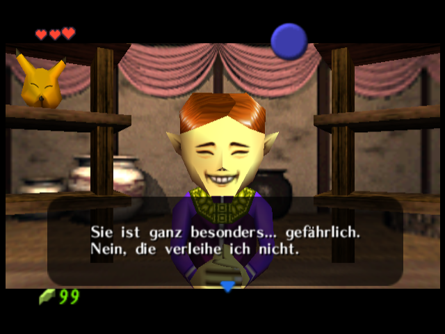
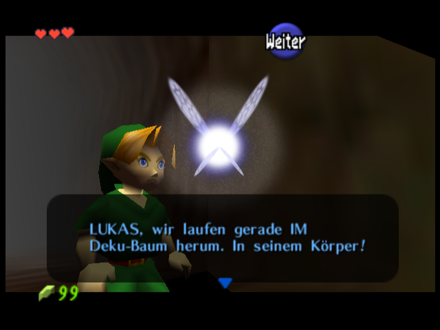
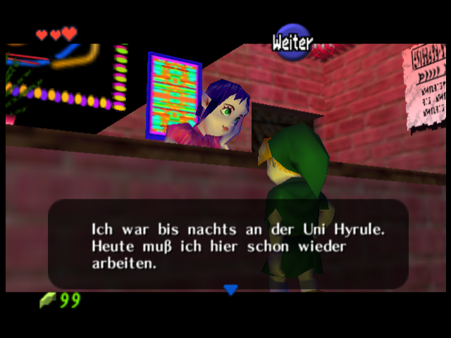
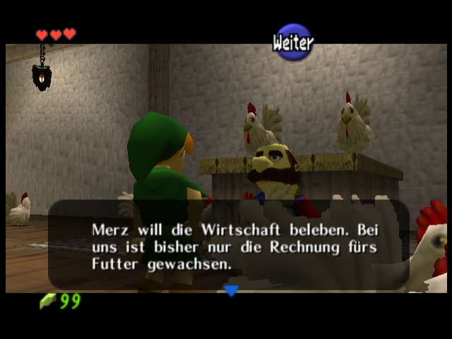
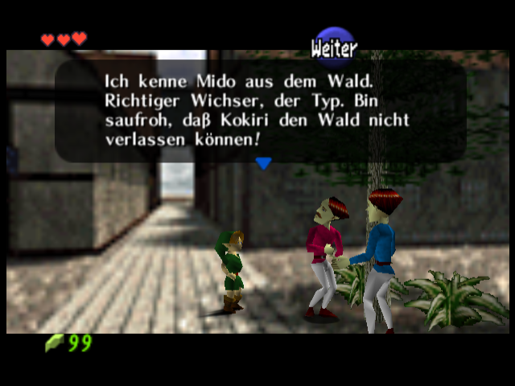

# Merzen der Bauer: Dialoge und Beans Rückblende

**[Aktuellen BPS-Patch herunterladen](Mr_Burns_Mr_Bean_DE_PAL10_Dialoge_Reiter.bps?raw=true)** · **[Fünf echte Ingame-Dialogbilder als ZIP](Dialogbeispiele_Ingame.zip?raw=true)** · [Quellen, Patch und Bilder](Merzen_Dialoge_Quellen_Patch_Bilder.zip?raw=true)

Den BPS-Patch mit der **unveränderten, entpackten Europa/PAL-1.0-ROM** in [RomPatcher.js](https://www.marcrobledo.com/RomPatcher.js/) kombinieren. Nicht auf die vorherige Mod anwenden. Normale Spielstände weiterverwenden; ältere Emulator-Save-States enthalten noch alte Texte und Modelle. Es wird keine vollständige ROM veröffentlicht.

83 neue beziehungsweise überarbeitete Nachrichten, alte Rechtschreibung, eine gezielte Korrektur von Beans Hosenübergängen in der schwarzweißen Rückblende und eine neue Kamera beim Wiegenlied. Thaddäus bleibt vorerst ein Gerücht; Rutos Modelle bleiben erhalten.

## Ausgewählte Ingame-Dialoge

### Im Maskenladen

### Navi im Deku-Baum, über C-oben

### Die Bowling-Studentin

### Talon auf der Farm

### Ein Stadtbewohner über Mido

## Bean und die schwarzen Flächen

[Neue Wiegenlied-Kamera](Bean_Korrekturen/Wiegenlied.png) · [Reit-Rückblende](Bean_Korrekturen/Reit_Rueckblende.png) · [Halle ohne Clipping-Dreiecke](Bean_Korrekturen/Halle_ohne_Clippingfehler.png)

Die schwarzen Dreiecke in den Hallen-Aufnahmen entstehen durch Software-Clipping des hier verwendeten GLideN64-/Mesa-Aufbaus. Dieselbe ROM und Kamera werden mit ausgeschaltetem `EnableClipping` korrekt dargestellt. Diese Emulator-Einstellung ist nicht im ROM-Patch gespeichert. Der beim Wiegenlied sichtbare leere Hofrand wurde zusätzlich durch einen anderen Kamerablick verkleinert.

Der Patch wurde mit RomPatcher.js samt Quellvalidierung bytegenau geprüft. Gezielte Szenenprüfungen mit 4 MB sowie die Rückblende mit 8 MB sind dokumentiert; kein vollständiger Spieldurchlauf oder Hardware-Test. Details stehen im Quellenarchiv unter `TESTING_DIALOGE.md`. [Prüfsummen](SHA256SUMS_Dialoge.txt).
