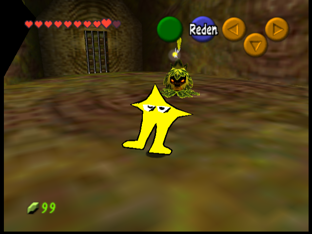
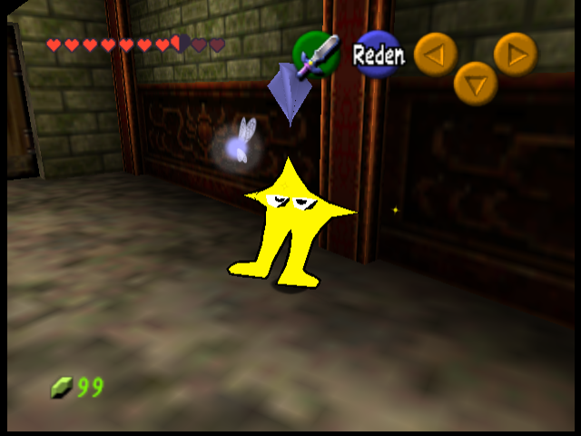
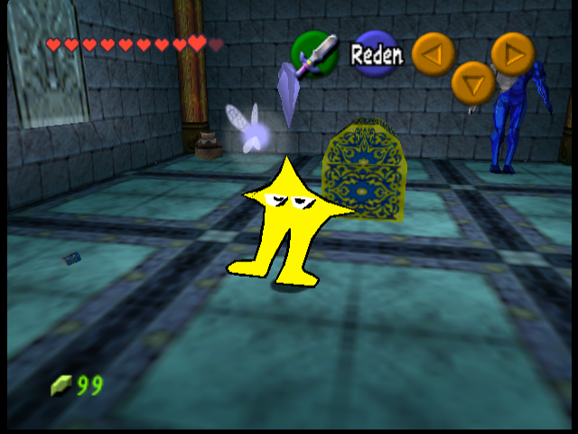
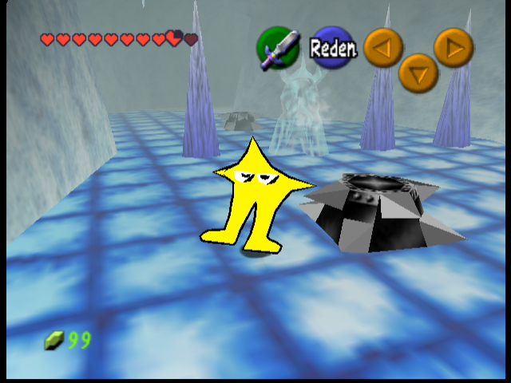
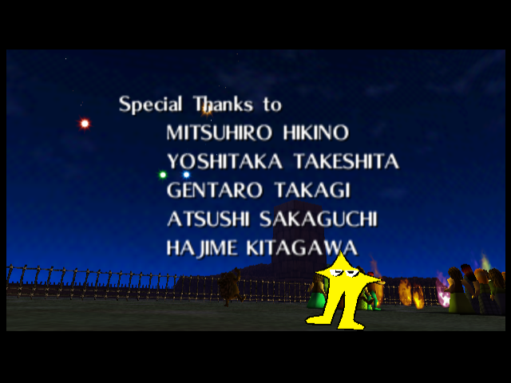

# Original Starwalker: ausgewählte Auftritte, V53

Echte Emulator-Aufnahmen mit den eingebauten Modellen und Platzierungen. Die vier Dungeon-Aufnahmen benutzen eine freie Kontrollkamera; Links Darstellung ist dort ausgeblendet, damit Starwalker unverdeckt sichtbar ist. Das Credits-Bild zeigt die ursprüngliche Spielkamera.

**Im Deku-Baum**

**Im Waldtempel**

**Im Wassertempel, bei Pepsiman und den Dosen**

**In der Eishöhle**

**Im letzten Schwenk der Feier vor dem Todesberg**

