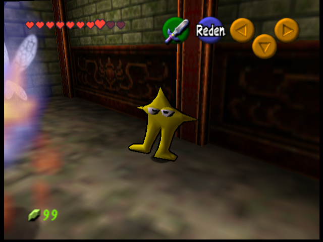
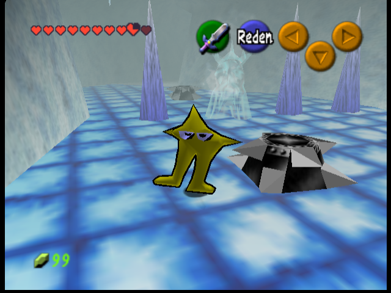
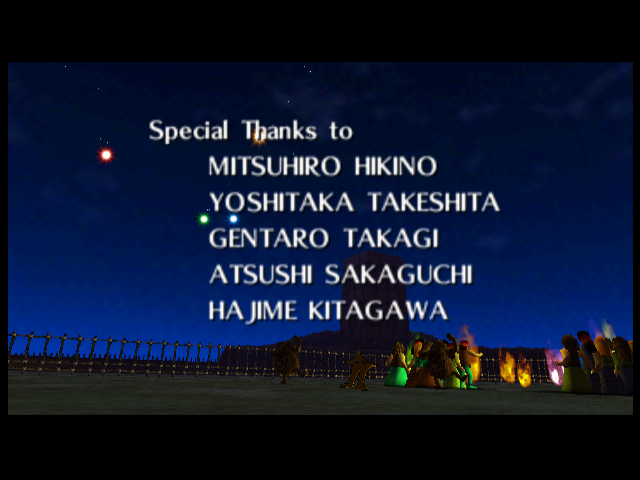

# Starwalker: Umgebungslicht und Hintergrund, V54

Die Dungeonbilder sind Emulator-Kontrollaufnahmen mit freier Kamera. Das Credits-Bild zeigt die ursprüngliche Kamerafahrt. Die Pinguin-Plätze und ihre Animationen bleiben gegenüber V53 unverändert.

**Beleuchtung im Waldtempel**

**Beleuchtung in der Eishöhle**

**Weiter hinten am Rand der Feier**

